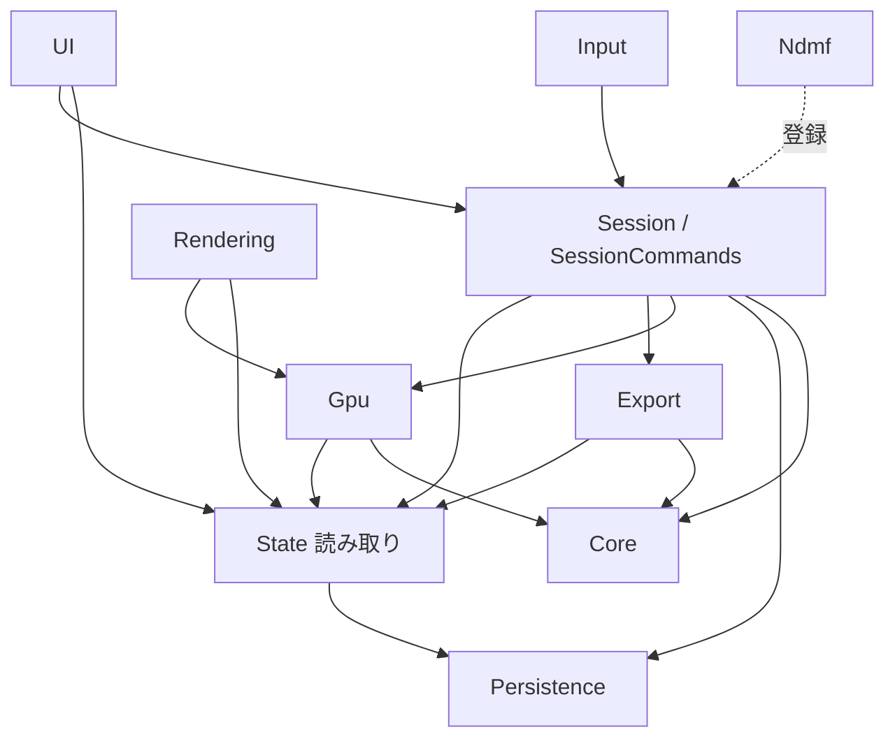

# UV Mask Maker V4 実装設計 - アーキテクチャとモジュール構成

機能の定義は [../Impl/overview.md](../Impl/overview.md)、UI は [../UI/ui_design.md](../UI/ui_design.md)。本書群は「どう作るか」を定めます。

| ドキュメント | 内容 |
| :--- | :--- |
| **architecture.md**（本書） | 設計原則、アセンブリとフォルダ構成、依存ルール、主要クラスの責務、機能追加の手順 |
| [state_and_lifecycle.md](state_and_lifecycle.md) | 状態の持ち方、UI との同期、Undo、ドメインリロードと Unity のライフサイクル、保存 |
| [gpu_pipeline.md](gpu_pipeline.md) | シェーダー、RenderTexture、マスク合成とペイントの GPU 処理、読み戻し |
| [implementation_plan.md](implementation_plan.md) | 実装順（マイルストーン）、事前検証、テスト、性能目標 |

---

## 1. 設計原則（KISS）

1. **真実は 2 か所だけ**: 作業内容は `EditState`、設定は `SettingsService`。それ以外（解析結果、GPU テクスチャ、ピッキング構造、UI の表示）はすべて**そこから作り直せるキャッシュ**として扱う。キャッシュが壊れても、消して作り直せば正しい状態に戻る。
2. **変更の入口は 1 つ**: 状態を変えるのはコマンド（`SessionCommands` → `EditCommands` / `SettingsService.Set`）だけ。UI 要素やシーン入力が状態を直接書き換えない。
3. **画像は GPU、判定とトポロジーは CPU**: 画素単位の処理（ラスタライズ、余白、ブラシ、合成、表示）はフラグメントシェーダーで行う。メッシュ解析・ピッキング・選択演算・圧縮は CPU（C#）で行う。コンピュートシェーダー・Burst・Jobs は使わない（依存と実行環境の差を増やさないため）。必要になった時に、該当クラスの内部だけを置き換える。
4. **ドメインリロードをまたいで生きる実行時オブジェクトを作らない**: 作業中の実行時オブジェクト（`WorkSession`）は、リロード直前に必ず終了し、リロード後に同じ手順で作り直す（[state_and_lifecycle.md](state_and_lifecycle.md) §5）。リロードをまたぐのは `ScriptableSingleton` に入れた状態と、ディスク上のファイルだけ。
5. **1 ファイル 1 責務**: 目安 300 行以内。超えたら責務で分ける。
6. **Unity 標準に任せる**: Undo は Unity の Undo、キー割当は Shortcut Manager、設定画面は `SettingsProvider`、浮動 UI は `Overlay`。独自の仕組みを作らない。

---

## 2. アセンブリ構成

| アセンブリ | 場所 | 参照 | 役割 |
| :--- | :--- | :--- | :--- |
| `Dennoko.UVMaskMaker.Core` | `Editor/Core/` | UnityEngine のみ（UnityEditor 不可） | 純粋な計算: 解析、選択演算、ピッキング、圧縮、画像の CPU 処理。単体テストの対象 |
| `Dennoko.UVMaskMaker.Editor` | `Editor/`（Core 以外） | Core | 状態、セッション、GPU、描画、入力、出力、UI |
| `Dennoko.UVMaskMaker.Ndmf` | `Editor/Ndmf/` | Editor、`nadena.dev.ndmf` | NDMF 連携。`versionDefines` で NDMF がある時だけ `UVMM_NDMF` を定義し、`defineConstraints` で無い時はコンパイルしない |
| `Dennoko.UVMaskMaker.Tests` | `Tests/Editor/` | Core、Editor、TestRunner | EditMode テスト |

- すべて Editor 専用（`includePlatforms: ["Editor"]`）。名前空間はアセンブリ名と同じ。
- Editor は Ndmf を参照しない。Ndmf 側が起動時に自分を登録する（依存の逆転、§5.3）。

---

## 3. フォルダ・ファイル構成

リポジトリのルートが、そのまま Unity プロジェクトの `Assets/dennokoworks/MaskMaker V4/` になります（他の dennokoworks ツールと同じ配置）。メニューは `dennokoworks/MaskMaker V4`。

```
/                                         … Assets/dennokoworks/MaskMaker V4/
├─ version.json (+ .meta)                 バージョン表示・更新確認（GUID 固定）
├─ Docs/                                  仕様・設計（Impl / UI / Design）
├─ Editor/
│  ├─ AssemblyInfo.cs                     InternalsVisibleTo（テスト用）
│  ├─ Dennoko.UVMaskMaker.Editor.asmdef
│  ├─ Core/                               … [asmdef] Dennoko.UVMaskMaker.Core（UnityEditor を参照しない）
│  │  ├─ Analysis/
│  │  │  ├─ MeshAnalysis.cs               入力 MeshInput・結果 MeshAnalysis・辺の型・粒度の enum
│  │  │  ├─ MeshAnalyzer.cs               解析の入口（各段を順に呼ぶ）とメッシュハッシュ（Impl mesh_analysis §9）
│  │  │  ├─ GroupTable.cs                 CSR のグループ表（Union-Find から / 恒等）
│  │  │  ├─ VertexIds.cs                  位置・UV の量子化と EdgeKey（§3–4）
│  │  │  ├─ EdgeTable.cs                  境界・シーム・ワイヤー・三角形隣接（§5）
│  │  │  ├─ UnionFind.cs
│  │  │  ├─ Grouping.cs                   島・パーツと外周（§6）
│  │  │  ├─ UVWrap.cs                     UV 範囲外の補正（§7）
│  │  │  └─ MirrorMapBuilder.cs           左右対称の対応表（§8）
│  │  ├─ Selection/
│  │  │  ├─ TriangleBits.cs               ビット列の基本操作と有効マスク
│  │  │  ├─ SelectionOps.cs               Full/Partial/None、トグル判定、全選択・反転・拡張・縮小・選択数
│  │  │  └─ MirrorResolver.cs             対称グループの投票
│  │  ├─ Picking/
│  │  │  ├─ MeshRaycaster.cs              Möller–Trumbore（マテリアルの Cull に従う）
│  │  │  └─ UVGrid.cs                     UV グリッド（重なった全候補、回り込み）
│  │  ├─ Imaging/
│  │  │  ├─ PaintRle.cs                   手塗りの連長圧縮
│  │  │  ├─ PolygonFill.cs                矩形・投げ縄の偶奇塗り
│  │  │  ├─ MaskEncoder.cs                D → 白黒 / チャンネル書き込み
│  │  │  └─ ImportThreshold.cs            取り込みの輝度・アルファ判定
│  │  └─ Util/  Fnv1a.cs, Leb128.cs
│  │
│  ├─ State/                              … 真実の置き場
│  │  ├─ EditState.cs                     ScriptableSingleton（選択ビット・PaintRle・TargetKey・MeshHash・リビジョン）
│  │  ├─ EditCommands.cs                  EditState を変える唯一の入口（Undo 記録）
│  │  └─ Settings/
│  │     ├─ Setting.cs                    Setting<T> と層の enum
│  │     ├─ SettingKeys.cs                全設定の宣言（Impl work_context_and_rendering §4.3 と 1 対 1）
│  │     ├─ SettingsService.cs            層の解決・書き込み・上書き判定・Changed
│  │     ├─ SettingCodec.cs               値 ⇄ 文字列
│  │     └─ Layers/  KeyValueStore.cs, SettingsLayers.cs（Session / Target / Project / User）
│  │
│  ├─ Persistence/
│  │  ├─ Persistence.cs                   StoragePaths・AtomicFile・SaveScheduler・SessionFile
│  │  └─ TargetKey.cs                     対象の識別子
│  │
│  ├─ Session/
│  │  ├─ SessionController.cs             Start / End / SwitchTarget / Restart と自動保存（SessionPersistence）
│  │  ├─ SessionLifecycle.cs              [InitializeOnLoad]。Unity のイベント → Controller、再開トークン、ショートカットのタグ
│  │  ├─ SessionSupport.cs                StartTransaction・Isolation・InteractionState
│  │  ├─ WorkSession.cs                   作業 1 回分の実行時オブジェクト（キャッシュを所有）
│  │  ├─ SessionCommands.cs               ユーザー操作の意味づけ（UI・ショートカット・入力はここだけを呼ぶ）
│  │  └─ WorkMesh/WorkMesh.cs             WorkMesh・IWorkMeshSource・WorkMeshSources・RendererMeshSource・PoseWatcher
│  │
│  ├─ Gpu/
│  │  ├─ GpuResources.cs                  資源の生成・解放・リーク掃除、RenderTargetScope、ShaderIds
│  │  ├─ TriMesh.cs                       TriMesh（+ 三角形フラグ）と LineMesh
│  │  ├─ MaskPipeline.cs                  Island / Coverage / 縮小 / 余白 / D
│  │  ├─ PaintSurface.cs                  PaintRT と PaintRle の同期、GpuReadback
│  │  └─ PaintOps.cs                      ブラシ・図形・取り込みのパス、ShapeMask、ViewInfo / MirrorInfo
│  │
│  ├─ Rendering/
│  │  ├─ SceneOverlay.cs                  SceneView への描画（マスク・シーム・ホバー・カーソル・修飾キーのバッジ）
│  │  └─ UVViewRenderer.cs                UV ビューの RT 描画
│  │
│  ├─ Input/
│  │  ├─ MaskMakerTool.cs                 EditorTool（入力の受け口）
│  │  ├─ SceneInput.cs                    SceneView の入力の解釈、ブラシ半径、迷い検知ヒント（Hints）
│  │  ├─ Gestures.cs                      SelectGesture（両ビュー共用）・ScenePaintGesture・PaintCommit
│  │  └─ MaskMakerShortcuts.cs            [Shortcut] / [ClutchShortcut]
│  │
│  ├─ Export/
│  │  ├─ SourceImage.cs                   元ファイルのバイト列から読む・元サイズ・最近傍の拡縮
│  │  ├─ OutputPaths.cs                   保存先・上書き・連番
│  │  ├─ MaskExporter.cs                  マスク PNG と MaskTexturePostprocessor（初回インポートだけ設定）
│  │  ├─ UVLayoutExporter.cs
│  │  ├─ MaskImporter.cs
│  │  └─ MaterialApplier.cs
│  │
│  ├─ UI/
│  │  ├─ Common/
│  │  │  ├─ DennokoTheme.uss (+ .meta)    スキルのテーマ（GUID 固定）
│  │  │  ├─ MaskMaker.uss (+ .meta)       .mm-* の固有クラス
│  │  │  ├─ DennokoUIFont.cs              スキルのフォント（ウォームアップ文字は UI の全日本語）
│  │  │  ├─ L10n.cs                       表示文字列（ja / en）と Notifier（メッセージの出口）
│  │  │  └─ UiCommon.cs                   UiAssets・UiHub・Bind・UiRules・Icons・TargetResolver
│  │  ├─ Window/
│  │  │  ├─ MaskMakerWindow.cs / .uxml    ヘッダー・サマリ・フッター・ステータスバー
│  │  │  ├─ TargetCard.cs
│  │  │  ├─ UVCard.cs                     UV ビューのカード（表示を戻す・ベース重ね・UV 展開図ウィンドウを開く）
│  │  │  ├─ UVLayoutWindow.cs/.uxml       UV 展開図の書き出しウィンドウ（フローティング）
│  │  │  ├─ UVViewElement.cs              UV ビュー本体（表示・選択・ペイント・ズーム/パン・ドロップ取り込み）
│  │  │  └─ OutputCard.cs
│  │  ├─ Scene/
│  │  │  ├─ CapsuleOverlay.cs / .uxml     手元カプセル（Overlay + ITransientOverlay。既定はシーンビューの左下）
│  │  │  └─ SceneHud.cs                   ラジアル・トースト・ヒント
│  │  ├─ SettingsPages/MaskMakerSettingsPages.cs   Preferences / Project Settings、Hierarchy の右クリック
│  │  └─ Version/  DennokoVersionChecker.cs, MaskMakerVersion.cs
│  │
│  └─ Shaders/
│     ├─ UVMaskMakerCommon.hlsl           UV → クリップ座標（上下反転はここだけ）、フラグ、距離関数
│     ├─ UVRaster.shader                  Island / Coverage / PaintWorld / ColorFill
│     ├─ ImageOps.shader                  Downsample / DilateH / DilateV / PaintView / ImportOr / Copy
│     ├─ Overlay.shader                   Scene / UVView
│     └─ Line.shader                      Line3D / LineUV
│
└─ Tests/Editor/                          … [asmdef] Dennoko.UVMaskMaker.Tests（UNITY_INCLUDE_TESTS の時だけ）
   ├─ Core/                               解析・選択・ピッキング・画像処理
   └─ Persistence/                        session.bin・連番
```

小さな型は使う側のファイルにまとめています（例: `ShaderIds` は `GpuResources.cs`）。1 ファイルが 300 行を超えたら分けます。

## 4. 依存ルール



| 規則 | 理由 |
| :--- | :--- |
| Core は UnityEditor・他の層を参照しない。static な可変状態を持たない | テストでき、どこからでも安全に呼べる |
| State は UI・Gpu・Session を参照しない | 真実の置き場が表示や実行時の都合に引きずられない |
| UI は Gpu を直接操作しない（UV ビューの RT を表示するだけ） | 描画の変更が UI に波及しない |
| UI / Input が状態を変える時は必ず `SessionCommands` を呼ぶ | 変更の入口を 1 つにし、Undo・保存・通知の漏れを防ぐ |
| サービスは `WorkSession` が所有し、必要なクラスへコンストラクタで渡す。サービスロケーターや static な参照で取りに行かない | 寿命が `WorkSession` と一致し、破棄漏れが起きない |
| static で保持してよいのは `SessionController.Current`（リロードで消えても再開処理が作り直す）、イベントの購読（`SessionLifecycle` / `UiHub` / `SceneHud`）、ファイルを読み直せばよいキャッシュ（`SettingsService` の永続層、`SaveScheduler` の予約）だけ | ドメインリロード時の不整合を防ぐ |

---

## 5. 主要クラスの責務

### 5.1 実行時オブジェクトの所有関係

```
SessionController (static Current)
└─ WorkSession                          … 作業 1 回分。End で全部 Dispose
   ├─ Renderer target / TargetKey
   ├─ WorkMesh                          … ローカル頂点・法線、PoseRevision
   ├─ MeshAnalysis                      … UV チャンネルが変わると作り直す
   ├─ MeshRaycaster / UVGrid
   ├─ InteractionState                  … ホバー中のグループ、ドラッグ中の操作
   ├─ Gpu: TriMesh, LineMesh×n, MaskPipeline, PaintSurface, PaintOps, ShapeMask
   ├─ SceneOverlay / UVViewRenderer
   ├─ Isolation
   └─ PoseWatcher
```

### 5.2 コマンドの 2 段構成
- **`SessionCommands`**（Session）: ユーザー操作を意味に変える。例: `Click(triangle, modifiers)` → 粒度・対称・スマートトグルを解決して「この三角形集合を追加」という形にし、`EditCommands` を呼ぶ。作業中でなければ何もしない。
- **`EditCommands`**（State）: `EditState` を変える低レベル操作。`SetSelection(bits, undoName)`、`CommitPaint(rle, undoName)`、`Clear()`。Undo の記録、リビジョン更新、保存予約、変更通知をここで必ず行う。

### 5.3 作業メッシュの供給元
```csharp
public interface IWorkMeshSource
{
    int Priority { get; }                         // 大きいほど優先（NDMF > Renderer）
    bool TryCreate(Renderer target, out WorkMesh mesh, out string info);
}
```
`WorkMeshSources` は登録された供給元を優先度順に試します。`Dennoko.UVMaskMaker.Ndmf` は `[InitializeOnLoad]` で `NdmfMeshSource` を登録するだけで、本体は NDMF の有無を知りません。

---

## 6. 機能追加の手順（例）

| 追加したいもの | 触る場所 |
| :--- | :--- |
| 設定項目 | `SettingKeys.cs` に 1 行（キー・既定値・書き込み層）。UI は `Bind` で結ぶだけ。保存・層の解決・●表示は自動 |
| 選択操作（例: 同じ材質の島を全部選ぶ） | `Core/Selection/SelectionOps.cs` に純粋関数 → `SessionCommands` に入口 → ショートカット / ラジアルに登録 |
| ペイントツール | `PaintSubMode` に値 → 形状が「画面上の図形」なら `PolygonFill` で ShapeMask を作るだけで既存パスが使える。新しい判定が要る時だけ `UVRaster.shader` にパスを足す |
| 出力形式 | `Export/` にクラスを 1 つ追加し、`MaskPipeline` の D を `GpuReadback` で受け取る。パスは `OutputPaths` を使う |
| 作業メッシュの取得方法（他の非破壊ツール） | `IWorkMeshSource` を実装し、別アセンブリから登録 |
| 対応シェーダーのマスクスロット | `MaterialApplier` の候補判定は名前ベースなので通常は不要。順位を変える時だけ表を追加 |
