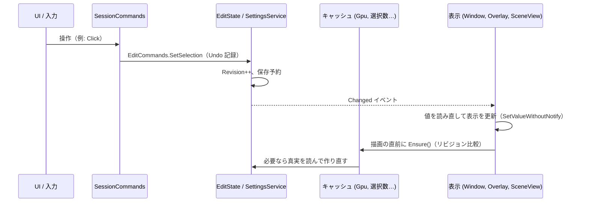

# UV Mask Maker V4 実装設計 - 状態管理・UI 同期・ライフサイクル

目的: **内部状態と UI 表示が食い違わないこと**、および **ドメインリロード・Play モード・シーン切替をまたいでも値が失われず、二重に初期化されないこと**。

---

## 1. 状態の分類

すべての値を次の 4 種類のどれかに入れ、種類ごとに置き場所と寿命を固定します。

| 種類 | 例 | 置き場所 | リロードをまたぐか | 作り直し方 |
| :--- | :--- | :--- | :-: | :--- |
| **作業内容（真実）** | 選択ビット、手塗り（PaintRle）、TargetKey、MeshHash | `EditState`（ScriptableSingleton、Undo 対象） | ○ | — |
| **設定（真実）** | 解像度、ファイル名、モード、ブラシサイズ、色… | `SettingsService` の各層（Session 層は ScriptableSingleton、他はファイル / EditorPrefs） | ○ | — |
| **キャッシュ** | 作業メッシュ、解析結果、GPU テクスチャ、ピッキング構造、選択数 | `WorkSession` が所有 | ✕（リロード前に破棄） | 真実から再計算 |
| **一時的な操作状態** | ホバー中のグループ、ドラッグ中の操作、ラジアル表示中、トースト | `InteractionState` / 各 UI コントローラ | ✕ | 次の入力で自然に戻る |

**規則**: UI 要素（`VisualElement` の値、トグルの ON/OFF、青枠のクラス）は状態を持たない。表示は常に「真実」と「キャッシュ」から作る。

### 1.1 EditState
```csharp
// [FilePath] を付けない = ディスクには書かない（保存は SessionFile が行う）
sealed class EditState : ScriptableSingleton<EditState>
{
    [SerializeField] string targetKey;
    [SerializeField] ulong meshHash;
    [SerializeField] int[] selectedBits;
    [SerializeField] byte[] paintRle;

    [NonSerialized] public int SelectionRevision;   // 変わるたびに +1
    [NonSerialized] public int PaintRevision;
    public event Action<EditChange> Changed;        // Selection | Paint | Target
}
```
- `ScriptableSingleton` はドメインリロードで中身が保たれ、Unity の Undo スタックからの参照も生き続けるので、**再コンパイルの後も Ctrl+Z で作業を戻せる**。
- リビジョンは `[NonSerialized]` で、リロード後は 0 から始まる。キャッシュもリロードで捨てられるので、両方が 0 からそろう。

### 1.2 SettingsService
- `Get(Setting<T>)` は Session → Target → Project → User → 既定 の順に解決（Impl work_context_and_rendering §4.1）。
- `Set(Setting<T>, value)` は設定ごとの書き込み層へ書き、`Changed(key)` を発行し、`Revision` を +1 する。
- `ResetToLower(Setting<T>)` は書き込み層の値を消す（●のクリック）。
- `IsOverridden(Setting<T>)` は ● の表示判定。
- Target 層は作業開始時に対象のファイルを読み込み、対象が替わると差し替える。作業していない時の Target 層は空。

---

## 2. 変更の流れ（単方向）



### 2.1 2 つの仕組みの使い分け
- **Push（イベント）**: 「何かが変わった」ことだけを伝える。受け取った側は UI の値を読み直す、または `SceneView.RepaintAll()` / `MarkDirtyRepaint()` を呼ぶだけ。
- **Pull（リビジョン比較）**: 重い派生データ（GPU テクスチャ、選択数、ホバーの外周）は、使う直前に `Ensure()` で「自分が作った時の入力リビジョン」と現在のリビジョンを比べ、違えば作り直す。

イベントを取りこぼしても、次に描画する時にリビジョンで必ず追いつきます。逆にイベントが余分に来ても、リビジョンが同じなら何もしません。

### 2.2 キャッシュの入力と作り直し条件

| キャッシュ | 入力（これが変わったら作り直す） |
| :--- | :--- |
| `MeshAnalysis`, `UVGrid`, `TriMesh` の UV | 作業メッシュの構造、`UVChannel` |
| `TriMesh` の位置・法線、`LineMesh`（3D）、`MeshRaycaster` | `WorkMesh.PoseRevision` |
| 三角形フラグバッファ | `SelectionRevision`、`TargetSubmesh` |
| Coverage | 解析、`TargetSubmesh`、出力サイズ |
| Island | フラグバッファ、出力サイズ |
| PaintRT | `PaintRevision`（GPU 側がそのリビジョンを反映済みかを `PaintSurface` が記録） |
| PaintLow / D | Island、Coverage、PaintRT の更新、`PixelMargin` |
| 選択数 `12/480` | `SelectionRevision`、`Granularity`、`TargetSubmesh` |
| ホバーの外周 | ホバー中のグループ、`Granularity`、`PoseRevision` |

---

## 3. UI との結び付け

### 3.1 Bind ヘルパー
設定と UI 要素の結び付けはすべて `Bind` を通します。

```csharp
// 例: 解像度ボタン群、チェックボックス、スライダー
Bind.Toggle(toggle, SettingKeys.InvertMask, settings);
Bind.Choice(buttonGroup, SettingKeys.TextureSize, settings, new[] { 512, 1024, 2048, 4096 });
```

`Bind` が行うこと:
1. 結び付けた時点で現在値を読み、`SetValueWithoutNotify` で表示する。
2. `SettingsService.Changed(key)` を購読し、変わったら同じく `SetValueWithoutNotify` で表示し直す（自分が書いた変更も同じ経路で戻ってくる）。
3. ユーザーの入力を受けたら `SettingsService.Set` を呼ぶ。**表示はその場で変えない**（2 で戻ってくる値で表示する）。
4. 上書きマーク ● の表示と、クリックでの `ResetToLower`。
5. 要素がパネルから外れたら（`DetachFromPanelEvent`）購読を解除する。

`SetValueWithoutNotify` を使うので、表示の更新が再び `Set` を呼ぶループは起きません。

### 3.2 表示の判定は 1 か所
有効/無効や表示/非表示の判定（例: 「Base PNG がある時は解像度ボタンを無効」「サブメッシュが 1 つなら選択欄を隠す」「対称が ON なら青枠」）は `UiRules` の純粋関数にまとめ、ツールタブ・カプセル・ラジアルが同じ関数を呼びます。ビューごとに条件を書かないので、場所によって表示が食い違うことがありません。

### 3.3 ビューの生成と破棄

| ビュー | 結び付け | 解除 |
| :--- | :--- | :--- |
| `MaskMakerWindow` | `CreateGUI`（リロード後も Unity が呼ぶ） | 要素の `DetachFromPanelEvent` |
| `CapsuleOverlay` | `CreatePanelContent` | `OnWillBeDestroyed` |
| `SceneHud`（ラジアル・トースト・ヒント） | 作業開始時に各 SceneView の `rootVisualElement` へ追加。同名の要素が既にあれば先に外す（リロードで残った物の掃除） | 作業終了時 |
| `StartBadge` | `SceneView.duringSceneGui`（Idle の時だけ描く） | — |

どのビューも結び付けた直後に 1 回全体を読み直すので、リロード直後・ウィンドウを開き直した直後でも、最初の表示から正しい値になります。

### 3.4 モードとツールの表示
`IsPaintMode`、`Granularity`、`PaintSubMode`、`SymmetryEnabled`、`OverlayOnTop`、`IsolateTargetMesh`、`ScenePickPaused` も Session 層の設定として扱い、同じ `Bind` で表示します。キー操作（Tab、1/2/3、X など）もこれらを `Set` するだけなので、キー・カプセル・ラジアル・タブのどこで変えても全部の表示がそろいます。

`IsolateTargetMesh` のように Unity 側の状態を伴う設定は、`Changed` を受けた `WorkSession` が実際の孤立表示を切り替えます（表示が先に変わって実体が付いてこない、という順序にしない）。

---

## 4. Undo の扱い

| 場面 | 実装 |
| :--- | :--- |
| 1 回の変更 | `Undo.RecordObject(EditState.instance, 名前)` → 値を変更 → リビジョン更新 |
| ドラッグ（なぞり選択） | 開始時に `Undo.IncrementCurrentGroup()` して番号を覚え、変更のたびに `RecordObject`、終了時に `Undo.CollapseUndoOperations(番号)` |
| ストローク | 途中は GPU だけを更新し、マウスを離した時に読み戻した PaintRle を 1 回の `RecordObject` で書く |
| ダブルクリック | 1 回目のクリックのグループ番号を覚えておき、2 回目で `Undo.RevertAllDownToGroup(番号)` してからパーツ一括選択を記録 |
| マテリアル適用 | `Undo.RecordObject(material)` を同じグループで行う（`EditState` には触れない） |
| 対象の切替 | 切替前に保存し、`Undo.ClearUndo(EditState.instance)` してから新しい対象を読み込む（別の対象の履歴が混ざらないように） |
| Undo / Redo の実行後 | `Undo.undoRedoPerformed` で `EditState` が自分の内容を見直す。選択ビットと PaintRle のハッシュを前回と比べ、変わった方のリビジョンだけ上げて `Changed` を出す |
| ストローク中に Ctrl+Z | 進行中のストロークを破棄し、PaintRT を EditState の内容に戻す（`undoRedoPerformed` の処理で自然にそうなる） |

---

## 5. ライフサイクル

### 5.1 Unity のイベントと処理
`SessionLifecycle`（`[InitializeOnLoad]`）が static コンストラクタで 1 回だけ購読します。リロードで static は消え、コンストラクタがもう一度走るので、購読が二重になることはありません。

| Unity のイベント | 処理 |
| :--- | :--- |
| `AssemblyReloadEvents.beforeAssemblyReload` | 作業中なら再開トークンを `SessionState` に書き、`End(save)` |
| `[InitializeOnLoad]` の後の `EditorApplication.delayCall` | リーク掃除（§5.4）。再開トークンがあり、Play モードでない時は `Resume` |
| `playModeStateChanged: ExitingEditMode` | 再開トークンを書き、`End(save)` |
| `playModeStateChanged: EnteredEditMode` | トークンがあれば `Resume` |
| `EditorSceneManager.sceneClosing`、`PrefabStage.prefabStageOpened / Closing` | `End(save)`、トークンは消す |
| `EditorApplication.quitting` | `End(save)` |
| `EditorApplication.update` | 対象が null になっていれば `End`。`SaveScheduler` の遅延保存。`PoseWatcher` の判定 |
| `Undo.undoRedoPerformed` | §4 |
| `MaskMakerWindow.OnDestroy` | `End(save)`（ウィンドウを閉じた時。リロードでは呼ばれないことを M0 で確認） |
| `EditorTool.OnActivated / OnWillBeDeactivated` | 作業中コンテキストの有効化 / `ScenePickPaused = true` |

- `SessionState`（Unity の API）はリロードをまたいで残り、Unity を終了すると消えます。再開トークンには TargetKey と対象 Renderer の `GlobalObjectId` を入れます。
- `Resume` は通常の `Start` と同じ処理です。違いは「Session 層を空にしない（モードやツールを保つ）」ことだけ。
- `Start` は、`EditState.targetKey` が対象と同じならメモリ上の内容をそのまま使い（Undo 履歴も保たれる）、違えばディスクから読み込みます。

### 5.2 作業の開始（StartTransaction）
```csharp
using var tx = new StartTransaction();
var session = new WorkSession(target);
tx.OnRollback(session.Dispose);
session.LoadSettings();          // Target 層
session.CreateWorkMesh();        // IWorkMeshSource
session.Analyze();
session.RestoreEditState();      // メモリ or ディスク（MeshHash 照合）
session.CreateGpuResources();
session.Isolate();               tx.OnRollback(session.ExitIsolation);
session.ActivateTool();          tx.OnRollback(session.RestorePreviousTool);
tx.Commit();
SessionController.Current = session;
```
途中で例外が出ると、登録した逆順で戻してから Idle に戻り、ステータスに原因を 1 行出します。中途半端な状態（孤立表示だけ残る、GPU 資源だけ残る）を作りません。

### 5.3 作業の終了
1. 進行中のストロークやドラッグを確定せずに破棄する。
2. `SessionFile` に保存（`SaveScheduler` の予約も消化）。
3. `SceneHud` の除去、`duringSceneGui` の購読解除。
4. 孤立表示の解除（自分が始めた時だけ）、作業前のツールへ戻す。
5. `WorkSession.Dispose()`: GPU 資源・作業メッシュを解放。
6. `SessionController.Current = null`、`Changed` を出して全ビューを Idle 表示に。

`End` は何度呼んでも安全にします（2 回目以降は何もしない）。

### 5.4 ネイティブ資源とリーク対策
- RenderTexture・Mesh・Material・Texture2D・GraphicsBuffer はすべて `GpuResources` 経由で作り、名前を `UVMaskMaker/…`、`hideFlags = HideAndDontSave` にする。`WorkSession.Dispose` で一括解放する。
- ネイティブオブジェクトはリロードで消えないため、解放漏れがあると残り続けます。リロード後の `delayCall` で `Resources.FindObjectsOfTypeAll` から `UVMaskMaker/` で始まる物を探して破棄します（この時点ではまだ何も作っていないので、見つかった物は全部漏れ）。
- `RenderTexture.IsCreated()` が false になった（デバイスロスト等）時は、そのテクスチャを作り直し、PaintRT は `EditState.PaintRle` から復元します。手塗りの真実は CPU 側にあるので失われません（失われるのは確定前のストロークだけ）。

### 5.5 SceneView 入力の受け口
- 入力は作業用 `EditorTool`（`MaskMakerTool.OnToolGUI`）で受けます。Unity の他のツールに切り替わると自動で一時停止になります（UI 設計 §2.6.7）。
- 描画（マスク・シーム）は一時停止中も続けるため、`SceneView.duringSceneGui` で行います（作業開始で購読、終了で解除）。
- ショートカットは作業中コンテキスト（`IShortcutToolContext`）に登録し、ツールが有効な間だけ効かせます。C（ラジアル）と Space（一時停止）は押している間だけ効くので `[ClutchShortcut]` にします。Undo / Redo は Unity 標準のものを使うので登録しません。

---

## 6. 保存

### 6.1 ファイル

| ファイル | 形式 | 書く時 |
| :--- | :--- | :--- |
| `UserSettings/UVMaskMaker/targets/{TargetKey}/session.bin` | バイナリ: マジック `UVMM`、形式バージョン、MeshHash、三角形数、選択ビット、PaintRle の長さと本体 | 変更の 2 秒後、終了、対象の切替、出力、リロード前、Unity の終了 |
| `UserSettings/UVMaskMaker/targets/{TargetKey}/settings.json` | `{"version":1,"values":[{"key":"…","value":"…"}]}` | Target 層の値を変えた 0.5 秒後 |
| `ProjectSettings/UVMaskMaker.json` | 同上 | Project 層の値を変えた時 |
| `EditorPrefs["UVMaskMaker.User"]` | 同上（JSON 文字列） | User 層の値を変えた時 |

- 値は `SettingCodec` で文字列にします（`JsonUtility` は Dictionary を扱えないため、キーと値の配列にする）。知らないキーは読み飛ばし、書く時はそのまま残します（新しいバージョンで足した設定を古いバージョンで消さない）。
- 書き込みは `AtomicFile`（一時ファイルに書いて置き換え）で行います。
- 形式バージョンが新しすぎるファイルは読まずに無視します（壊さない）。

### 6.2 外部からの変更
`ProjectSettings/UVMaskMaker.json` はバージョン管理で書き換わることがあります。`EditorApplication.focusChanged` でエディタにフォーカスが戻った時に更新日時を比べ、変わっていれば読み直して `Changed` を出します。
