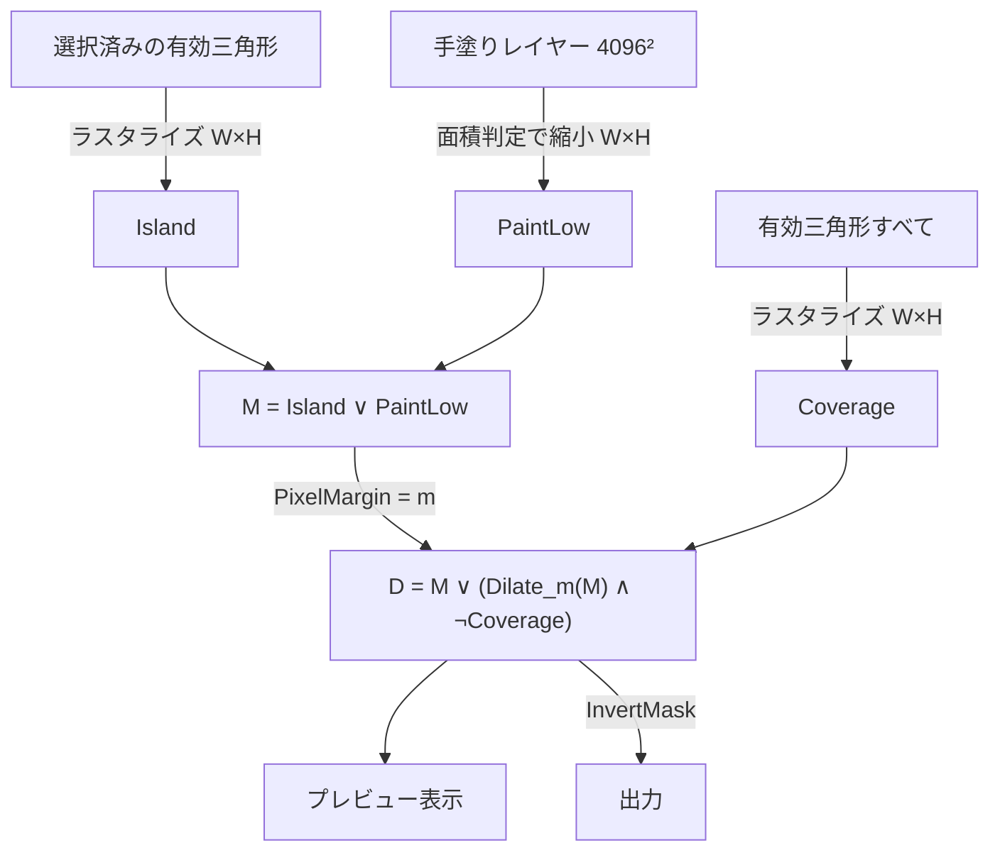

# UV Mask Maker 機能仕様書 - マスク画像処理・統合履歴 (Mask Processing & Unified History)

## 1. 概要

本モジュールは、選択三角形のラスタライズ、余白（ダイレーション）、手塗りエンジン、既存マスクの取り込み、マスクの合成順序、および選択と手塗りを一体で扱う統合履歴・統合クリア・作業状態の保存と復元を規定します。

ここでは「どの画素がどの値になるか」を定義します。GPU / CPU のどちらで計算するかは [../Design/gpu_pipeline.md](../Design/gpu_pipeline.md) で定めます。

---

## 2. マスク合成パイプライン

出力解像度を $W \times H$（`TextureSize`、チャンネル書き込みで Base PNG がある時はそのサイズ）とします。すべての中間画像は 2 値（0 / 1）です。

1. **Island**: 選択済みかつ有効な三角形を $W \times H$ にラスタライズ（§4）。
2. **Coverage**: 有効な三角形すべてを同じ規則でラスタライズ。対象テクスチャ上で「どこかの面が使っている画素」。
3. **PaintLow**: 手塗りレイヤー（4096²）を $W \times H$ へ面積判定で縮小（§6.2）。
4. **M = Island ∨ PaintLow**。
5. **D**: M を余白 $m$ ピクセル分だけ広げる。ただし広げる先は Coverage = 0 の画素（どの面も使っていない空き領域）に限る（§5）。
6. **プレビュー**: SceneView と UV ビューには D をそのまま（ポイントサンプリングで）表示する。出力解像度を下げた時の粗さがそのまま見える。
7. **出力**: D（`InvertMask` 時は ¬D）を [export.md](export.md) の色規則で書き出す。

> [!IMPORTANT]
> **プレビューと出力は同じ D から作る**。表示用に別の解像度や別の手順で作り直さない。

> [!NOTE]
> 旧仕様の「余白は手塗りを合成する前のアイランドマスクだけに適用する」という制約は廃止しました。余白を空き領域に限ったことで、面の上では手塗りのストロークも消しゴムで削った境界も太らず、シームに接した手塗りの縁にも余白が付きます。

---

## 3. 統合編集履歴 (Unified History)

選択と手塗りは出力マスクを構成する一体の作業なので、Undo・Redo・Clear を共通にします。

### 3.1 履歴の実体
- 作業状態 `EditState`（[overview.md](overview.md) §5.4）を **Unity の Undo スタック**に記録する。Ctrl+Z / Ctrl+Y（Ctrl+Shift+Z）と Edit メニューの Undo History は Unity 標準のものがそのまま効く。
- 1 件に記録されるのは、変更前の `SelectedBits` と `PaintRle`（変わらなかった方は差分が無いので実質コストは無い）。
- 手塗りは連長圧縮（§3.4）で持つので、4096² でも 1 件は通常数十〜数百 KB。件数の上限は Unity の Undo 設定に従う（旧仕様の 20 件上限は廃止）。

### 3.2 履歴を積むタイミング（1 操作 = 1 件）

| 操作 | 単位 |
| :--- | :--- |
| 選択操作（クリック、なぞり、ダブルクリック、全選択、反転、拡張/縮小 1 段） | 操作ごと。なぞりはドラッグ終了までで 1 件。ダブルクリックは [selection_system.md](selection_system.md) §4.3 |
| 手塗り | ストローク（マウスを押してから離すまで）ごと |
| 既存マスクの取り込み | 取り込みごと |
| 統合クリア | 1 件 |
| 前回作業の復元 | 作業開始時に 1 件（Ctrl+Z で空の状態に戻せる） |
| マテリアル適用 | 1 件（[export.md](export.md) §5。マテリアルの変更も同じ件に含む） |

**履歴に影響しない操作**: 出力解像度・余白・反転の変更、選択の単位・ペイントツールの変更、表示の切替。旧仕様の「解像度変更で履歴をリセット」は、手塗りを解像度から独立させたので廃止。

### 3.3 統合クリア
1. 現在の状態を履歴に 1 件積む。
2. 選択ビットをすべて 0 にする（他のサブメッシュも含む全体）。
3. 手塗りレイヤーを全消去する。

確認ダイアログは出さず、Undo トーストで取り消せるようにします（UI 設計 §1）。

### 3.4 手塗りの連長圧縮（PaintRle）
- 4096² の 2 値画像を行優先で走査し、値 0 から始まる「0 の連長、1 の連長、0 の連長…」を交互に並べる。各連長は LEB128 可変長整数で書く。
- 全面が空なら 4 バイト程度、典型的なマスクで数十〜数百 KB。
- 同じ画像は必ず同じバイト列になる（比較・ハッシュに使える）。

### 3.5 作業状態の保存と復元
- **保存内容**: `EditState` 一式（TargetKey、MeshHash、SelectedBits、PaintRle）を 1 ファイルに書く。保存先は [work_context_and_rendering.md](work_context_and_rendering.md) §4.2。
- **保存タイミング**: 最後の変更から 2 秒後（連続した変更はまとめる）、作業終了、対象の切替、出力、スクリプトの再コンパイル直前、Unity の終了時。Undo / Redo による変更も保存対象。
- **書き込み**: 一時ファイルに書いてから置き換える（書き込み途中で落ちても前回の保存が残る）。
- **復元**: 作業開始時、同じ TargetKey の保存があり MeshHash が一致すれば復元し、情報 `前回の作業を復元` を出す。一致しなければ破棄して空で開始し、情報 `メッシュ変更のため復元なし` を出す。

---

## 4. 三角形ラスタライズ規則

UV 三角形を $W \times H$ の 2 値画像に塗る規則です。Island と Coverage は同じ規則で作ります。

### 4.1 座標変換
画素 $(i, j)$ は UV 空間の $[i/W, (i+1)/W) \times [j/H, (j+1)/H)$ を占め、中心は $((i+0.5)/W, (j+0.5)/H)$ です。UV は範囲外補正後の `TriUV`（[mesh_analysis.md](mesh_analysis.md) §7）を使い、画素座標は

$$x = u \times W, \quad y = v \times H$$

とします。GPU がテクスチャをサンプリングする時の対応と一致させるため、旧仕様の $\text{Clamp01}(u) \times (W-1)$ は廃止します（u に比例して最大 1px ずれ、範囲外の三角形が縁に焼き込まれていた）。

### 4.2 充填判定
画素中心が三角形の内側にある画素を 1 にします。辺上の画素は Top-Left rule に従い、隣接する 2 つの三角形の共有辺上の画素はちょうど一方にだけ属します（GPU のラスタライズ規則と同じ）。

### 4.3 回り込み
`NeedsWrap` の時は、各三角形を $(\pm1, 0), (0, \pm1), (\pm1, \pm1)$ ずらした 8 つの複製も同じ規則で描き、テクスチャの外にはみ出た部分を反対側の縁に描きます（Repeat サンプリングと同じ見え方）。

### 4.4 1px 未満の細い三角形
画素中心を 1 つも含まない三角形は描かれません。その画素は Coverage = 0 になるので、余白 $m \ge 1$ なら隣の選択領域から余白で埋まります。

---

## 5. 余白（空き領域に限ったダイレーション）

UV 境界付近でテクスチャサンプリングが隣の画素を拾い、白フチ（ブリード）が出るのを防ぐため、選択領域を外側へ広げます。

### 5.1 定義
$$D(p) = M(p) \;\lor\; \Big(\neg\,\text{Coverage}(p) \;\land\; \max_{\|q - p\|_\infty \le m} M(q)\Big)$$

- 広げる量はチェビシェフ距離 $m$（一辺 $2m+1$ の正方形）。旧仕様の「8 近傍膨張を $m$ 回くり返す」と同じ形になる。
- **Coverage = 1 の画素（他の面が使っている画素）には広げない**。隣り合う未選択の島の縁を塗らない。
- 広げる元 M には手塗りも含む。

### 5.2 計算方法
正方形の最大値フィルタは横方向と縦方向に分けて計算できます（横に $\pm m$ の最大値を取った画像に、縦に $\pm m$ の最大値を取る）。旧仕様の反復方式 $O(W H m^2)$ 相当に対して $O(W H m)$ で、$m$ を大きくしても速度がほとんど変わりません。

### 5.3 既定値
`PixelMargin` は 0〜32。既定は解像度に比例した推奨値 $\text{TextureSize} / 256$（512 → 2、1024 → 4、2048 → 8、4096 → 16）。

---

## 6. 手塗りエンジン

### 6.1 手塗りレイヤー
- 解像度は常に **4096 × 4096** の 2 値画像（UV 0〜1 全体）。出力解像度を変えても手塗りは変わらない（旧仕様の `EnsureSize` による最近傍拡縮と履歴リセットは廃止）。
- 塗ると 1、消すと 0。アイランドの選択には影響しない（消しゴムで選択済みの島を削ることはできない）。

### 6.2 出力解像度への縮小（面積判定）
出力画素 $(i, j)$ が手塗りレイヤー上で占める矩形に、$N \times N$ 個の標本点を等間隔に置き、半分以上が 1 なら PaintLow = 1 とします。

- $N = \text{clamp}(\lceil 4096 / \min(W, H) \rceil, 1, 8)$。512 なら 8×8、4096 なら 1（そのまま）。
- 判定は `count * 2 >= N * N`。
- 出力が 4096 を超える場合（Base PNG が 8192 など）は $N = 1$ の最近傍拡大。

### 6.3 ストローク
マウスを押してから離すまでを 1 ストロークとし、離した時点で手塗りレイヤーを確定して履歴に 1 件積みます（§3.2）。ストローク中もプレビュー（§2 の D）は随時更新します。

| ツール | SceneView | UV ビュー |
| :--- | :--- | :--- |
| **Brush** | **ワールド空間のブラシ**（§6.4）。マウス移動ごとに、前回の交点から今回の交点までの線分を半径 $r$ のカプセルとして塗る | 画面空間のカプセル。テクセル中心を UV ビューの画面座標に写し、線分からの距離が `BrushSize` 以下なら塗る |
| **Rect** | 画面上の矩形の内側に**投影される**面の画素を塗る（§6.5）。マウスを離した時に適用 | UV ビュー上の矩形の内側の画素を塗る |
| **Lasso** | 画面上の投げ縄の内側に投影される面の画素を塗る（§6.5） | UV ビュー上の投げ縄の内側の画素を塗る |
| **Eraser** | Brush と同じ形状で 0 を書く | 同左 |

- **Ctrl 押下中**はどのツールでも 0 を書く（消去）。Shift 押下中は 1 を書く（塗り。消しゴムでも塗りになる）。
- `BrushSize` は**画面上の半径（px）**。1〜300、既定 30。カーソルの円の大きさと塗られる大きさが常に一致する。
- 投げ縄の点は、前の点から画面上で 2px 以上動いた時だけ追加する（旧仕様の UV 距離 0.003 は UV の密度でばらつくため廃止）。始点と終点は自動で閉じ、内外は偶奇規則で決める。

### 6.4 ワールド空間ブラシ（SceneView）
旧仕様の「UV 上で前回の点から今回の点まで直線を引く」方式は、UV シームをまたぐとテクスチャ上の離れた 2 点を結んで、無関係な島の上に線を引いてしまいます。そこで、塗るかどうかを手塗りレイヤーの画素ごとにワールド空間で判定します。

1. 手塗りレイヤーの各画素について、その画素を覆う有効三角形上の点のワールド位置 $p$ と法線 $n$ を求める（三角形の UV 上での重心座標で頂点の位置・法線を補間）。
2. 線分 $[a, b]$（前回と今回のレイの交点）からの距離が $r$ 以下なら塗る。
3. **向きの判定**: X-Ray が OFF の時は、カメラの方を向いている面（$n \cdot (\text{カメラ位置} - p) > 0$、平行投影では $n \cdot (-\text{視線方向}) > 0$）だけを塗る。X-Ray が ON なら裏向きの面も塗る。
4. **半径**: $r = \text{BrushSize} \times$（交点の深度における 1px のワールド長）。
5. マウス移動でメッシュから外れた時はストロークを切り、次にメッシュに当たった点から新しい線分を始める（外れた区間を結ばない）。
6. クリックだけ（移動なし）は $a = b$ の 1 点。

これにより、シームをまたいでも正しく塗れ、UV の密度に関係なくモデル表面上でのブラシの大きさが一定になります。UV が三角形に覆われていない画素（UV の隙間）はシーンのブラシでは塗られず、余白（§5）で埋まります。

### 6.5 画面空間の矩形・投げ縄（SceneView）
1. 手塗りレイヤーの各画素のワールド位置 $p$ を §6.4 と同様に求め、カメラで画面座標へ投影する。
2. 投影位置が図形の内側にあり、向きの判定（§6.4 の 3）を満たす画素を塗る。
3. 判定は画面に見えている図形と一致するので、シームやカメラの向きに関係なく、見た目どおりに囲んだ範囲が塗られる。

### 6.6 左右対称
対称が ON の時、**SceneView のストローク**は対称位置にも同じ形で塗ります。画素のワールド位置 $p$ に加えて、X 反転した位置 $p'$（基準空間は [mesh_analysis.md](mesh_analysis.md) §8）でも判定を行い、どちらかが条件を満たせば塗ります（向きの判定には反転した法線を使う）。UV ビューのストロークは対称に反映しません（UV 配置が左右対称とは限らないため）。

---

## 7. 既存マスク画像の取り込み (Mask Import)

外部の PNG 等の黒い領域を手塗りレイヤーに加算（OR）します。

### 7.1 読み込み
- テクスチャアセットではなく**元ファイルのバイト列**を `ImageConversion.LoadImage` で読み、ファイルに書かれた値そのもの（sRGB で符号化された値）を使う。インポート設定（圧縮、sRGB、最大サイズ）の影響を受けない。
- 旧仕様の「Linear の RenderTexture へ Blit してから読む」方式は、sRGB 設定のテクスチャをリニア値に変換してしまい、しきい値 128 が sRGB 値でおよそ 186 相当になっていたため廃止。

### 7.2 判定と結合
$$\text{Luminance} = 0.299 R + 0.587 G + 0.114 B \quad (R, G, B \in [0, 255])$$

- **黒と判定する条件**: $\text{Luminance} < \text{BlackThreshold}$ かつ $A \ge 128$。透明部分（$A < 128$）は色に関わらず取り込まない。
- `BlackThreshold` は 0〜255、既定 128（Project 設定）。
- 判定した 2 値画像を最近傍で 4096² に拡大し、手塗りレイヤーへ OR で結合する。
- 履歴に 1 件積む。黒い部分が 1 画素も無い時は何も変更せず（履歴も積まず）、警告 `取り込める部分なし` を出す。
