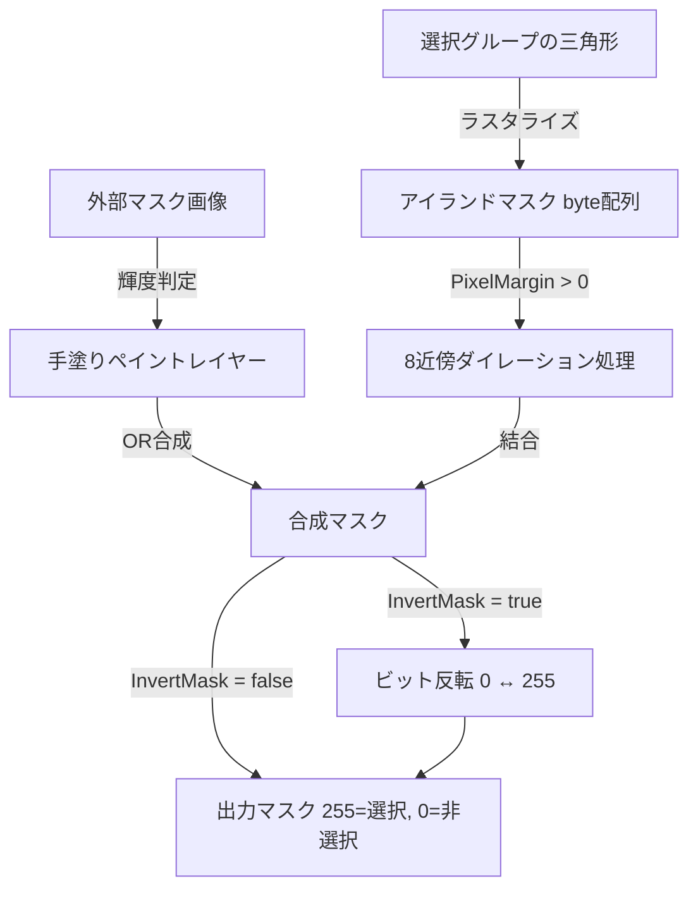

# UV Mask Maker 機能仕様書 - マスク画像処理・統合履歴 (Mask Processing & Unified History)

## 1. 概要

本モジュール（`MaskBuilder` および `MaskPainter` / `HistoryManager`）は、ベクトル形状（UV三角形・手塗り図形）のラスタライズ、ピクセル単位の画像処理（ダイレーション・インバート）、フリーハンドペイント処理、外部画像インポート、および**アイランド選択と手塗りを一元化した統合Undo/Redo・統合Clearシステム**を規定します。

---

## 2. マスク合成パイプライン (Composition Pipeline)

最終的に出力またはプレビューされるマスク画像は、以下の厳密な順序で合成処理が行われます。



> [!IMPORTANT]
> **ダイレーション適用のタイミング規則**:  
> ピクセルマージン（Dilation）は、必ず**手塗りレイヤーを合成する前**にアイランドマスクに対してのみ適用します。これにより、手塗りで描画したストロークや消しゴムで削った境界が意図せず太るのを防ぎます。

---

## 3. 統合編集履歴システム (Unified History & Action System)

アイランド選択と手塗りペイントは出力マスクを構成する一体の編集作業であるため、**Undo（戻る）、Redo（進む）、およびClear（消去）は完全に共通化**して管理されます。

### 3.1 統合スナップショット構造
```csharp
public class MaskEditSnapshot
{
    public HashSet<int> SelectedGroups;      // 選択グループのディープコピー
    public byte[] PaintMask;                 // 手塗りバッファのディープコピー
    public SelectionGranularity Granularity; // 粒度
}
```

### 3.2 履歴の蓄積タイミング
以下のいずれかのアクションが完了した直前に、変更前の状態を `UndoStack`（最大20件）へプッシュします：
1. **アイランド選択の変更**:
   - 3Dビューまたは2Dプレビューでのグループクリック（追加/除外/トグル）
   - 一括選択操作（全選択、選択反転、選択クリア）
2. **手塗りペイントストロークの完了**:
   - ブラシ、矩形、なげなわ、消しゴムのマウスボタンアップ時（1ストロークごと）
3. **外部マスク画像のインポート完了時**
4. **統合クリア（Clear All）実行時**

※新規アクションが実行された時点で、`RedoStack` は即座にクリアされます。

### 3.3 統合 Undo / Redo の動作
- **Undo 実行時**:
  - 現在の状態（`SelectedGroups` と `PaintMask`）を `RedoStack` に退避。
  - `UndoStack` から直前のスナップショットを取り出し、**選択状態と手塗りバッファを同時に復元**。
  - シーンビューオーバーレイおよびUVプレビューを再描画。
- **Redo 実行時**:
  - 現在の状態を `UndoStack` に退避。
  - `RedoStack` から次のスナップショットを取り出し、選択状態と手塗りバッファを同時に復元。

### 3.4 統合クリア (Unified Clear)
「クリア」操作は、アイランド選択と手塗りペイントの両方を同時に初期化します。
1. 現在の完全な状態を Undo スタックに保存。
2. `SelectedGroups.Clear()` を実行（アイランド選択の全解除）。
3. `Array.Clear(PaintMask, 0, PaintMask.Length)` を実行（手塗りの全消去）。
4. ダーティフラグを立ててプレビューとオーバーレイを全更新。

---

## 4. 三角形ラスタライザ仕様

UV座標 $(0.0 \sim 1.0)$ 上の三角形を、解像度 $W \times H$ のバイト配列 `byte[] mask`（$0$: 背景, $255$: 選択）にラスタライズします。

### 4.1 座標変換とバウンディングボックス
各頂点 $(u, v)$ をテクスチャピクセル空間 $(x, y)$ に変換します：
$$x = \text{Clamp01}(u) \times (W - 1), \quad y = \text{Clamp01}(v) \times (H - 1)$$
3頂点の外接矩形（Bounding Box: $\min X, \max X, \min Y, \max Y$）を計算し、その範囲内のピクセルのみ走査します。

### 4.2 充填判定（Edge Function & Top-Left Rule）
ピクセルの中心座標 $(x + 0.5, y + 0.5)$ について、三角形の各辺に対する有向符号付距離（Edge Function）を計算します。
$$\text{Edge}(a, b, c) = (c.x - a.x)(b.y - a.y) - (c.y - a.y)(b.x - a.x)$$
3辺のEdge関数値がすべて同符号（すべて $\ge 0$ またはすべて $\le 0$）であるピクセルを内側と判定し、値を `255` に設定します。境界上のピクセルは Top-Left fill convention に準拠して判定します。

---

## 5. ピクセルマージン（8近傍ダイレーション処理）

UVの境界付近でテクスチャサンプリングのズレによる白フチ（ブリード）を防ぐため、黒（選択）領域を外側に数ピクセル拡張します。

### 5.1 アルゴリズム
指定された反復回数（`iterations` = `PixelMargin`）分、以下の処理を繰り返します。
1. ソース配列 `src` を `dst` にコピー。
2. 全ピクセル $(x, y)$ を走査：
   - `src[y * W + x] == 255` の場合はそのままスキップ。
   - `src` が `0` の場合、周囲8近傍（上下左右および斜め）のピクセルを検査。
   - 8近傍のうちいずれか1つでも `255` が存在する場合、`dst[y * W + x] = 255` とする。
3. `src` と `dst` のバッファをスワップ。

---

## 6. 手塗りペイントエンジン (MaskPainter)

解像度 $W \times H$ の独立したペイント専用バッファ（`byte[] _paintMask`）を保持し、ピクセル単位での編集を行います。

### 6.1 タイルベースのダーティ管理
画面更新およびプレビュー更新を最適化するため、テクスチャ全体を $16 \times 16$ （計256個）のタイルに分割管理します。
- `bool[] _dirtyTiles`: 描画処理が発生した領域と交差するタイルのフラグを `true` に設定。
- 描画時に全テクスチャの転送を行わず、ダーティタイルのみ更新可能にします。

### 6.2 解像度変更仕様
エクスポート解像度などが変更された場合、`EnsureSize(newSize)` を実行します。
- **リサイズ手法**: 最近傍補間（Nearest-Neighbor）を用いて既存のペイントデータを拡大/縮小。
- **履歴のリセット**: 解像度変更時はメモリ保護および一貫性保持のため、統合履歴スタックをクリアします。

### 6.3 ペイントツール詳細仕様

| ツール | 入力パラメータ | 処理アルゴリズム |
| :--- | :--- | :--- |
| **Brush** (ブラシ) | 開始UV, 終了UV, 半径 $r$, 消しゴムフラグ | **Bresenhamアルゴリズム**で前回のUV座標から今回のUV座標までの補間直線を算出し、直線上の各点について中心からのユークリッド距離 $dx^2 + dy^2 \le r^2$ のピクセルを塗る。 |
| **Rect** (矩形) | 開始UV, 終了UV, 消しゴムフラグ | 2つのUV座標を対角とする軸平行矩形（AABB）のピクセル範囲を算出し、矩形内部を一括で塗る。 |
| **Lasso** (なげなわ) | UV点列リスト, 消しゴムフラグ | UV点列で囲まれた多角形を**スキャンライン法**（偶奇交差判定）で充填。点列の始点と終点は自動的に連結される。最小サンプリング距離（UV距離 0.003以上）で点を間引いて記録。 |
| **Eraser** (消しゴム) | 上記ツールと同様 | 描画値として `255` ではなく `0` を書き込む。アイランド選択マスクには影響を与えず、手塗りレイヤーのみを消去する。 |

---

## 7. 既存マスク画像インポート仕様 (Mask Import)

外部のPNG等のテクスチャアセットを読み込み、その黒い領域を手塗りレイヤーに加算（OR結合）します。

### 7.1 リサイズと色空間
1. 読み込むテクスチャアセットから一時 `RenderTexture`（Linear, ARGB32）を生成し、現在のマスク解像度へ `Graphics.Blit` でリサイズ。
2. リニア色空間の `Texture2D`（RGBA32）に `ReadPixels` で取り込み。

### 7.2 輝度判定と結合
各ピクセルの sRGB 知覚輝度（Perceptual Luminance）を算出します：
$$\text{Luminance} = \frac{R}{255} \times 0.299 + \frac{G}{255} \times 0.587 + \frac{B}{255} \times 0.114$$
- **閾値判定**:  
  $$\text{Luminance} < \frac{\text{BlackThreshold}}{255.0} \implies \text{手塗りバッファ}[i] = 255$$
  - `BlackThreshold` は $0 \sim 255$（デフォルト: 128）。
- **Undo対応**: インポート実行直前の統合状態を Undo スタックに退避します。
