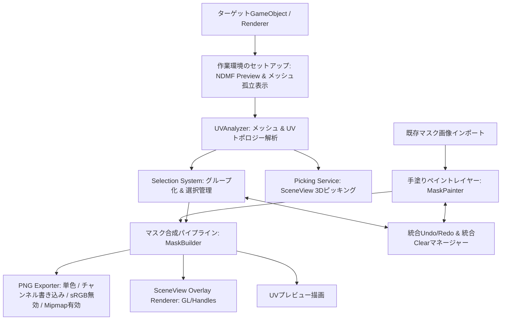

# UV Mask Maker 機能仕様書 (Functional Specification) - Overview

本ドキュメント群は、Unity 2022.3 LTS 以上を対象としたエディタ拡張ツール **UV Mask Maker** の機能仕様を定義するものです。  
UIレイアウトやGUIコントロールの配置等には依存せず、純粋な**機能要件・データ構造・計算アルゴリズム・入出力仕様**を規定しています。クリーンルーム実装（完全な再実装）を行う際の仕様ベースとして利用できます。

---

## 1. ツールの目的と提供価値

3Dモデル（アバターや衣装等）のメッシュに対して、UVアイランド、接続メッシュ、個別ポリゴン（三角形）、およびフリーハンドの手塗りを組み合わせて選択・ペイントを行い、以下の形式でマスクを出力するエディタ拡張機能です。

1. **白黒マスクテクスチャ（PNG）出力**（sRGB無効/リニア、Mipmap有効、解像度、インバート、UVシーム余白拡張対応）
2. **既存テクスチャへのチャンネル別（RGBA）書き込み**（特定チャンネルのみにマスクを反映）
3. **反転マスクの同時出力**（元マスクと反転マスクの完全なファイル名競合回避）

> [!NOTE]
> 過去バージョンに存在した「頂点カラーへのベイク機能」は廃止されました。テクスチャマスクの生成・編集に特化しています。

---

## 2. 全体アーキテクチャとデータフロー



---

## 3. モジュール構成と仕様書一覧

各モジュールの詳細仕様は、以下のドキュメントに分割して記述されています。

| ドキュメント | 対象機能・責務 |
| :--- | :--- |
| **[mesh_analysis.md](file:///c:/Users/dennn/Programming/UnityExtension/UVMaskMaker/Docs/Impl/mesh_analysis.md)** | メッシュ読み込み、Read/Write修復、頂点・UV量子化、3種の粒度（UVアイランド / 接続メッシュ / ポリゴン）分割、UVシーム・境界エッジ抽出 |
| **[selection_system.md](file:///c:/Users/dennn/Programming/UnityExtension/UVMaskMaker/Docs/Impl/selection_system.md)** | 選択状態の管理、集合演算、粒度間変換ロジック、3Dレイキャストピッキング、ピッキング一時停止機能 |
| **[mask_processing.md](file:///c:/Users/dennn/Programming/UnityExtension/UVMaskMaker/Docs/Impl/mask_processing.md)** | 三角形ラスタライズ、ピクセルマージン（8近傍ダイレーション）、手塗りペイントエンジン、マスク画像インポート、合成順序、**統合Undo/Redo & 統合Clear** |
| **[export.md](file:///c:/Users/dennn/Programming/UnityExtension/UVMaskMaker/Docs/Impl/export.md)** | PNG出力、sRGB無効/Mipmap有効化、チャンネル別書き込み（Base PNG合成）、テクスチャインポーター設定自動化、**元マスク・反転マスクの同時競合回避** |
| **[work_context_and_rendering.md](file:///c:/Users/dennn/Programming/UnityExtension/UVMaskMaker/Docs/Impl/work_context_and_rendering.md)** | **NDMF Preview連携 & その場（In-Place）作業環境（メッシュ孤立表示 / 一時作業シーン）**、SceneViewオーバーレイ描画（GL投影・シーム描画）、設定データ構造 |

---

## 4. 共通型定義・データモデル

### 4.1 選択粒度 (SelectionGranularity)
```csharp
public enum SelectionGranularity
{
    UVIsland = 0,      // 位置とUVの端点を共有する辺で接続された三角形群
    ConnectedMesh = 1, // 位置のみを共有する頂点で接続された三角形群
    Polygon = 2        // 個別の三角形単位
}
```

### 4.2 ペイントツール種別 (PaintSubMode)
```csharp
public enum PaintSubMode
{
    Brush = 0,  // フリーハンド円形ブラシ
    Rect = 1,   // UV矩形塗りつぶし
    Lasso = 2,  // 任意多角形（投げ縄）塗りつぶし
    Eraser = 3  // 消しゴム（手塗りレイヤーの消去）
}
```

### 4.3 コアデータ構造

#### UVTriangle
```csharp
public struct UVTriangle
{
    public int triIndex;          // メッシュの三角形インデックス (mesh.trianglesのオフセット / 3)
    public int v0, v1, v2;        // メッシュ頂点インデックス
    public Vector2 uv0, uv1, uv2; // 指定UVチャンネルのUV座標
}
```

#### SelectionGroups (粒度ごとのグループ分割情報)
```csharp
public class SelectionGroups
{
    public List<UVIsland> Groups = new List<UVIsland>();
    public Dictionary<int, int> TriangleToGroup = new Dictionary<int, int>(); // triIndex -> groupIndex
    public int Count => Groups.Count;
}
```

#### 統合編集スナップショット (UnifiedEditState)
アイランド選択と手塗りペイント履歴を統一管理するためのスナップショット構造です。
```csharp
public class UnifiedEditState
{
    public HashSet<int> SelectedGroups; // 選択グループの複製
    public byte[] PaintMask;            // 手塗りマスク配列の複製
    public SelectionGranularity Granularity; // スナップショット時の選択粒度
}
```
