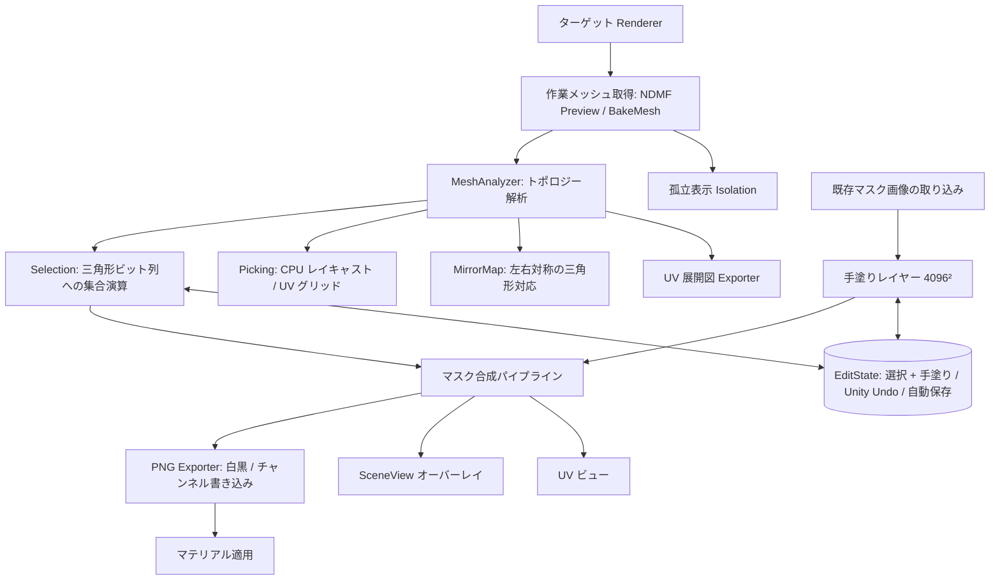

# UV Mask Maker 機能仕様書 (Functional Specification) - Overview

本ドキュメント群は、Unity 2022.3 LTS 以上を対象としたエディタ拡張ツール **UV Mask Maker** の機能仕様を定義するものです。  
UIレイアウトやGUIコントロールの配置等には依存せず、**機能要件・データ構造・計算アルゴリズム・入出力仕様**を規定します。

- UI / 操作体系: [../UI/ui_design.md](../UI/ui_design.md)
- 実装方式（モジュール構成、CPU/GPU の分担、状態管理、ライフサイクル）: [../Design/architecture.md](../Design/architecture.md)

本書は「何が得られるべきか（結果の定義）」を定め、Design は「どう作るか」を定めます。両者が食い違う場合は本書の定義を正とし、Design を直します。

---

## 1. ツールの目的と提供価値

3Dモデル（アバターや衣装等）のメッシュに対して、UVアイランド、接続メッシュ、個別ポリゴン（三角形）、およびフリーハンドの手塗りを組み合わせて選択・ペイントを行い、以下の形式でマスクを出力するエディタ拡張機能です。

1. **白黒マスクテクスチャ（PNG）出力**（sRGB無効/リニア、Mipmap有効、解像度、インバート、UV境界の余白拡張対応）
2. **既存テクスチャへのチャンネル別（RGBA）書き込み**（特定チャンネルのみにマスクを反映）
3. **反転マスクの同時出力**（元マスクと反転マスクの完全なファイル名競合回避）
4. **UV展開図（ワイヤーフレーム）PNG出力**（外部ペイントソフトの下絵用）
5. **出力マスクのマテリアルへの適用**（適用先スロットを対象ごとに記憶）

> [!NOTE]
> 過去バージョンに存在した「頂点カラーへのベイク機能」は廃止されました。テクスチャマスクの生成・編集に特化しています。

---

## 2. 全体を通した原則

| 原則 | 内容 |
| :--- | :--- |
| **選択は三角形単位** | 選択状態はメッシュの三角形ごとのビット列で持つ。選択の単位（島 / パーツ / 面）は「次の操作で扱うまとまり」を決めるだけで、切り替えても既存の選択は変わらない。 |
| **手塗りは出力解像度と独立** | 手塗りレイヤーは常に内部解像度 4096×4096 で保持する。出力解像度を下げても手塗りは劣化せず、戻せば元の細かさに戻る。 |
| **プレビュー＝出力** | SceneView と UV ビューに表示するマスクは、現在の出力解像度・余白で合成した**出力と同一の画像**（色付けのみ異なる）。解像度を下げた時の粗さをその場で確認できる。 |
| **履歴は 1 本** | 選択・手塗り・取り込み・クリア・マテリアル適用は Unity の Undo スタックに 1 件ずつ積む。Ctrl+Z / Ctrl+Y は Unity 標準のものがそのまま効く。 |
| **作業は失われない** | 作業状態（選択・手塗り）は対象ごとにディスクへ自動保存し、終了・対象切替・再コンパイル・Unity 再起動の後も復元する。 |

---

## 3. 全体アーキテクチャとデータフロー



---

## 4. モジュール構成と仕様書一覧

| ドキュメント | 対象機能・責務 |
| :--- | :--- |
| **[mesh_analysis.md](mesh_analysis.md)** | メッシュ読み込み、Read/Write修復、頂点・UV量子化、3種の粒度分割、UVシーム・境界エッジ抽出、三角形隣接、UV 範囲外の扱い、左右対称の対応表、メッシュ識別ハッシュ |
| **[selection_system.md](selection_system.md)** | 三角形単位の選択状態、スマートトグル・なぞり選択・パーツ一括選択、拡張/縮小、左右対称の適用、3D / 2D ピッキング、ピッキング一時停止 |
| **[mask_processing.md](mask_processing.md)** | マスク合成順序、三角形ラスタライズ、余白（空き領域限定のダイレーション）、手塗りエンジン（ワールド空間ブラシ・画面空間の矩形/投げ縄）、統合履歴、作業状態の保存と復元、既存マスク取り込み |
| **[export.md](export.md)** | PNG出力、チャンネル別書き込み、インポーター設定、保存先と上書き/連番、UV展開図出力、マテリアル適用 |
| **[work_context_and_rendering.md](work_context_and_rendering.md)** | NDMF 連携とその場（In-Place）作業、作業メッシュとポーズ追従、孤立表示、作業の開始/終了/自動再開、SceneView オーバーレイ描画、設定項目と保存階層 |

---

## 5. 共通型定義・データモデル

### 5.1 選択粒度 (SelectionGranularity)
```csharp
public enum SelectionGranularity
{
    UVIsland = 0,      // 位置とUVの端点を共有する辺で接続された三角形群（表示名: 島）
    ConnectedMesh = 1, // 位置のみを共有する頂点で接続された三角形群（表示名: パーツ）
    Polygon = 2        // 個別の三角形単位（表示名: 面）
}
```

### 5.2 ペイントツール種別 (PaintSubMode)
```csharp
public enum PaintSubMode
{
    Brush = 0,  // 円形ブラシ（SceneView ではワールド空間、UV ビューでは画面空間）
    Rect = 1,   // 矩形塗りつぶし（画面空間）
    Lasso = 2,  // 投げ縄塗りつぶし（画面空間）
    Eraser = 3  // 消しゴム（ブラシ形状で手塗りレイヤーを消去）
}
```
どのツールでも Ctrl 押下中は「消去」として働く（形状は現在のツールのまま）。

### 5.3 解析結果 (MeshAnalysis)
三角形は `0 … T-1` の連番（`mesh.triangles` の先頭からのオフセット / 3、全サブメッシュ通し）で識別します。

```csharp
public sealed class MeshAnalysis
{
    public int TriangleCount;            // T
    public int[] TriSubmesh;             // [T] 三角形の所属サブメッシュ
    public Vector2[] TriUV;              // [3T] 範囲外補正後の UV（mesh_analysis §7）
    public bool NeedsWrap;               // 補正後も [0,1] をはみ出す三角形がある
    public GroupTable[] Groups;          // [粒度] UVIsland / ConnectedMesh（Polygon は暗黙）
    public int[] AdjStart, AdjTris;      // 三角形隣接（CSR）
    public List<UVBorderEdge> BorderEdges;          // UV 空間の境界辺
    public List<(int v0, int v1)> SeamEdges3D;      // 3D 空間のシーム辺
    public int[] MirrorTri;              // [T] 左右対称の相手（無ければ -1）
    public float MirrorMatchRate;        // 対応が見つかった三角形の割合
    public ulong MeshHash;               // 作業状態の照合用
}

public sealed class GroupTable           // CSR 形式のグループ表
{
    public int Count;                    // K
    public int[] GroupStart;             // [K+1] GroupTris 内の開始位置
    public int[] GroupTris;              // [T] グループ順に並べた三角形番号
    public int[] TriToGroup;             // [T] 三角形 → グループ番号
}
```

### 5.4 作業状態 (EditState)
選択と手塗りは 1 つの作業状態として扱い、履歴（Undo）・保存・復元の単位とします。

```csharp
public sealed class EditState
{
    public string TargetKey;     // 対象の識別子（work_context_and_rendering §2.5）
    public ulong MeshHash;       // 作業時のメッシュハッシュ（不一致なら復元しない）
    public int[] SelectedBits;   // 三角形の選択ビット列（32 三角形 / 要素）
    public byte[] PaintRle;      // 手塗りレイヤー 4096² の連長圧縮（mask_processing §3.4）
}
```
