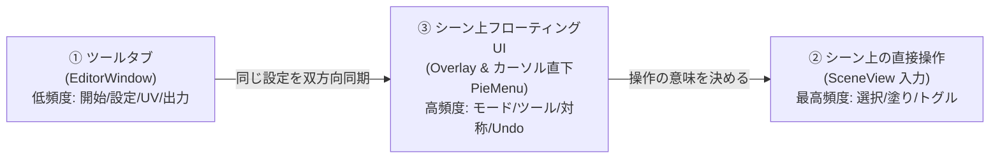

# UV Mask Maker V4 UI/UX 設計書

対象: `Docs/Impl/*.md` の機能要件を UI に落とし込んだ設計。
スタイル/コンポーネント定義: `dennokoworks_color_schema` スキル（UI Toolkit / UXML + USS、ダークテーマ固定、フローティングデザイン）。

---

## 1. コンセプト

> **「説明書なしで、最短手数で、マウス移動ゼロでマスクが出る」**

| 原則 | 具体策 |
| :--- | :--- |
| **ゼロ・トラベル (Zero Travel)** | マウスを画面端のツールバーへ往復させない。**カーソル直下ラジアルメニュー（C長押し）** と **Ctrl+右ドラッグでの手元ブラシ伸縮** で、手の位置を動かさずに操作完結 |
| **スマート・トグル (Smart Toggle)** | 「追加モード」「除外モード」の切替を廃止。**未選択をクリックで追加、選択済みをクリックで除外**。ダブルクリックでパーツ丸ごと全選択 |
| **左右対称 (X-Mirror)** | VRCアバター特化。**X対称選択（Xキー）** で腕・足・袖・靴などの選択クリック数とカメラ回転を **一律50%カット** |
| **1 クリック開始** | Hierarchy で対象を選ぶ → ツールタブの大ボタン 1 つ（またはシーン上の「Mask Maker で編集」）で作業開始。UV 解析・孤立表示・NDMF 取得・カメラフォーカスは全自動 |
| **状態駆動 UI** | 「未開始 / 作業中 / 出力」の状態に応じて、**今必要な UI だけ**を出す。無関係な設定は見せない |
| **失敗しない** | 全操作が Undo 可能（選択＋手塗り統合履歴）。破壊的操作（クリア）は即実行 + Undo トースト、確認ダイアログは出さない |
| **出力〜適用まで最短** | **Ctrl+S で一発出力**。出力完了トーストから **「マテリアルに即時適用」** を1クリックで完了（ドラッグ＆ドロップ不要） |

---

## 2. 3 領域の役割分担



| 領域 | 使う場面 | 置く機能 | 置かない機能 |
| :--- | :--- | :--- | :--- |
| **① ツールタブ** | 作業の前後・設定変更 | 対象指定と作業開始/終了、UV/サブメッシュの設定、UV プレビュー（2D ピッキング・ペイント兼用）、出力詳細設定（余白・チャンネル別書き込み）、表示設定、言語 | 作業中に何度も切り替えるもの |
| **② シーン直接操作** | 作業の本体 (90%の作業) | スマートクリック（追加/除外トグル）、ダブルクリック（パーツ全選択）、ドラッグ塗り、Ctrl+右ドラッグ（ブラシ伸縮）、Shift+ホイール（選択拡張/縮小）、ホバーハイライト、カメラ保護 | 設定値の変更 |
| **③ フローティング & 手元HUD** | 作業中の切替 (10%の作業) | **カーソル直下ラジアルメニュー (Cキー長押し)**、手元カプセルツールバー、粒度切替、ペイントツール、X-Mirror(対称)、Undo/Redo/Clear、全選択/反転、一時停止、クイック出力(Ctrl+S) | 出力先フォルダや詳細チャンネル設定 |

**設定の単一情報源**: `MaskSettings` を 1 つだけ持ち、①と③は同じ値を参照・即時同期する（片方で変えるともう片方の表示も更新）。

---

## 3. 作業フロー（状態遷移）

```
[Idle 未開始] ──作業開始──▶ [Working 作業中] ──出力(Ctrl+S)──▶ [Exported 完了] ──1クリック──▶ [マテリアル適用]
      ▲                            │  ▲                                │
      └────────── 終了 ◀───────────┘  └── Undo/Redo/再編集 ─────────────┘
```

| 状態 | ツールタブ | シーン | フローティング |
| :--- | :--- | :--- | :--- |
| **Idle** | 対象ドロップ欄＋巨大な「作業開始」ボタンのみ（他カードは非表示/淡色） | 通常のシーン。Renderer 選択中なら右上に小バッジ「Mask Maker で編集 ▶」 | 非表示（開始バッジのみ） |
| **Working** | 設定カード＋UV プレビュー＋出力カード | 対象メッシュを孤立表示＆自動カメラフォーカス、シーム線、マスク投影、ホバーハイライト | ツールバー表示 ＋ Cキーでラジアルメニュー |
| **Exported** | ステータスバー緑「保存完了」＋「マテリアルに適用」＋「Ping」 | そのまま編集継続可 | トースト通知：「出力完了 [マテリアルに適用] [Ping]」 |

**自動処理（ユーザーに操作させない）**
- 開始時: Read/Write 自動修復、UV 解析、`IsolateTargetMesh` による孤立表示、NDMF プレビューメッシュ取得、一時コライダー生成、対象オブジェクトへの自動カメラフォーカス（`SceneView.FrameSelected` 相当）。
- 終了時: `ExitIsolation`、コライダー破棄、オーバーレイ解除。
- UV チャンネルに UV が無い場合: UV0 へ自動フォールバックし、ステータスバーに警告（黄）を 1 行出すだけ。
- 対象選択が変わった場合: 作業中は無視。Idle なら自動で対象欄を更新。

---

## 4. ① ツールタブ（EditorWindow）

### 4.1 基本構造（スキル準拠）

```
VisualElement.dennoko-root
├─ .dennoko-header         … タイトル + .dennoko-version-label + ↻ (.dennoko-version-reload-button)
├─ .dennoko-separator
├─ ScrollView.dennoko-scroll   … 状態に応じてカードを出し分け（これだけが縮む）
│    ├─ .dennoko-card  [Target]
│    ├─ .dennoko-card  [Source]      … Working のみ
│    ├─ .dennoko-card  [UV Preview]  … Working のみ
│    ├─ .dennoko-card  [Display]     … Working のみ（折りたたみ）
│    └─ .dennoko-card  [Output]      … Working のみ
├─ .dennoko-footer .dennoko-card  … 主アクション（作業開始 / 出力）  ※固定クローム
└─ .dennoko-status          … Ready / success / error
```

- ルートに `dennoko-root`、`DennokoUIFont.Apply(root)`、固定クロームは `flex-shrink:0`。
- フッターの主ボタンは状態で切り替わる: Idle=「作業開始」、Working=「出力」（`.dennoko-button-primary`）。**常に画面下に 1 つだけ主ボタン**。

### 4.2 ワイヤーフレーム（Working 状態）

```
┌ UV Mask Maker            v4.0.0 ↻ ┐ .dennoko-header
├────────────────────────────────────┤
│ ┌ 対象 ─────────────────────────┐ │
│ │ [Body (SkinnedMeshRenderer)  ▼]│ │  ObjectField / 作業中は固定表示
│ │ サブメッシュ [すべて ▼]  UV [UV0 ▼] │
│ │ [ 終了 ]                       │ │  .dennoko-button-secondary
│ └────────────────────────────────┘ │
│ ┌ 選択の単位 ───────────────────┐ │
│ │ [UVアイランド][接続メッシュ][ポリゴン] │  青枠で現在値 (.dennoko-button-active)
│ └────────────────────────────────┘ │
│ ┌ UV プレビュー ────────────────┐ │
│ │ ┌────────────────────────┐    │ │
│ │ │   2D UV (クリック/塗り可) │    │ │  選択=cyan、シーム=red
│ │ └────────────────────────┘    │ │
│ │ ☐ ベーステクスチャを重ねる  不透明度 ▬▬●─ │
│ └────────────────────────────────┘ │
│ ▸ 表示設定 (折りたたみ)            │
│ ┌ 出力 ─────────────────────────┐ │
│ │ ファイル名 [uv_mask        ]   │ │
│ │ 解像度 [512][1024][2048][4096] │ │  青枠で現在値
│ │ 余白 ▬▬●──── 2px              │ │
│ │ ☐ 反転して出力  ☐ 反転も同時保存 │ │
│ │ 保存先 ◉ テクスチャと同じ場所    │ │
│ │       ○ [Assets/GeneratedMasks] │ │
│ │ ☐ チャンネルに書き込む          │ │
│ │    ☑R ☐G ☐B ☐A  [Base PNG: なし]│ │  ← 親トグルONでのみ展開(インデント)
│ └────────────────────────────────┘ │
├────────────────────────────────────┤
│        [        出  力        ]    │ .dennoko-footer .dennoko-button-primary
│ ● Ready                            │ .dennoko-status
└────────────────────────────────────┘
```

### 4.3 カード詳細と UX 判断

| カード | 内容（MaskSettings） | UX 判断 |
| :--- | :--- | :--- |
| **対象** | 対象 Renderer、`TargetSubmesh`（-1=すべて）、`UVChannel`、終了ボタン | Idle ではここに大きなドロップ欄。Hierarchy で Renderer を選択中なら自動入力。サブメッシュが 1 つなら項目ごと非表示。UV が 1 チャンネルしか無ければ UV ドロップダウンも非表示 |
| **選択の単位** | `Granularity` 3 択 | 3 択ボタン群。選択中のみ `.dennoko-button-active`。③にも同じものがあり同期。切替時は「全包含ルール」で選択を変換するため、**選択が減る場合のみ**ステータスに「n 件が解除されました」を表示 |
| **UV プレビュー** | ラベルマップ 2D ピッキング、ペイント兼用、`PreviewOverlayBaseTex`、`PreviewOverlayAlpha` | シーンと**同じツール・同じモード**でそのまま操作可能。ホバーで該当グループをハイライト。ホイールでズーム、中ボタンでパン。ベース重ねトグルは「重ねる」ON のときだけ不透明度スライダーを表示 |
| **表示設定** (折りたたみ) | `OverlayOnTop`(X-Ray)、`OverlayDepthOffset`、`OverlaySeamThickness`、`DisableAA`、`SelectedSceneColor`、`SeamColor`、`IsolateTargetMesh` | 普段触らないため既定は閉。X-Ray と孤立表示のみ③にも置く（頻度が高い） |
| **出力** | `FileName`、`TextureSize`、`PixelMargin`、`InvertMask`、`SaveInvertedToo`、`UseTextureFolder`、`OutputDir`、チャンネル書き込み一式 | 既定のまま押せばよい構成。`UseTextureFolder=ON` なら `OutputDir` を隠す。`SaveInvertedToo` は「反転も同時保存」とし、実ファイル名（`name.png` / `name_inv.png`）を灰色でプレビュー表示。チャンネル書き込み OFF なら R/G/B/A と Base PNG は非表示（インデント展開） |

### 4.4 出力時の挙動
- 押下 → ステータス「書き出し中…」→ 成功で `.dennoko-status--success`「保存: Assets/…/uv_mask.png」＋右端に `Ping` ボタン。
- 競合回避（元/反転ペアの番号一致）は自動で行い、確定したファイル名を成功メッセージに出す。
- 選択も手塗りも空のとき: 出力ボタンは押せるが、ステータスに黄色警告「何も選択されていません（全白で出力）」を出し、**実行は止めない**。
- 失敗は `.dennoko-status--error` に原因 1 行（例: 書き込み権限）。

---

## 5. ② シーン上での直接操作（最高頻度: ゼロ・トラベル操作系）

画面端のボタンを押すためにマウスを往復させる必要をなくし、**3Dメッシュの手元だけで90%の作業を完結させる操作体系**です。

### 5.1 操作マップ

| 入力 | 選択モード | ペイントモード | UX上の短縮効果 |
| :--- | :--- | :--- | :--- |
| **ホバー** | 指したグループを白縁ハイライト（選択済みなら赤縁にして「消去」を予告） | ブラシ円を表面追従投影 / 矩形・投げ縄ガイド | 実行前に結果が分かり誤操作ゼロ |
| **左クリック (スマートトグル)** | **未選択なら追加、選択中なら除外**（トグル操作） | ブラシ: 1点塗り / 消しゴム: 1点消去 | **追加/除外の切替クリックが不要（0クリック化）** |
| **ダブルクリック** | **接続メッシュ全体（そのパーツ丸ごと）を一括選択** | — | 服のパーツ単位の選択が1アクションで完了 |
| **左ドラッグ** | 始点グループの状態に合わせ、通過グループを連続追加/連続除外（なぞり選択） | 連続ストローク / 範囲 / 囲み塗り | 複数アイランドを1ストロークで一網打尽 |
| **Ctrl + 右ドラッグ** (左右) | — | **ブラシサイズの手元無段階伸縮** | **上部スライダーへのマウス往復を完全消滅** |
| **C キー長押し** (または Space) | **カーソル直下にラジアルメニュー (Pie Menu) を表示** | 同左 | **ツールバーへの長距離マウス移動をゼロ化** |
| **X キー** | **左右対称 (X-Mirror) の ON/OFF 切替** | 同左 | **両腕・両足のクリック数＆カメラ回転を 50% 削減** |
| **Shift + マウスホイール** | **選択範囲の拡張 (Grow) / 縮小 (Shrink)** | — | 隣接アイランドへ直感的に選択を広げる |
| **Alt / 中ボタンドラッグ** | **Unity標準カメラ操作（完全保護・ツールは入力非消費）** | 同左 | 視点移動で誤って塗ってしまう事故を防止 |
| **Ctrl+Z / Ctrl+Shift+Z** | **統合 Undo / Redo（選択＋手塗りの一体履歴）** | 同左 | 手元で即座にリカバリー |
| **Ctrl + S** | **クイック保存（現在の設定で即座にPNG出力）** | 同左 | ツールタブへ戻らずキー1つで保存完了 |
| **Tab** | 選択 ⇄ ペイント モード切替 | 同左 | 片手キーボードで瞬時に往復 |
| **1 / 2 / 3** | 粒度切替: アイランド / 接続メッシュ / ポリゴン | — | 左手だけで粒度変更 |
| **B / M / L / E** | — | ブラシ / 矩形 / 投げ縄 / 消しゴム | ペイントツールの即時切替 |

---

### 5.2 カーソル直下ラジアルメニュー (Pie Menu) の仕様

`C` キー（または設定で `Space`）を押し下げている間、**現在のマウスカーソル直下に直径 180px のリング状メニューが瞬時にポップアップ**します（dennokoworks Surface1 + Outline、青枠アクティブ）。

```
           [ ↑ モード: 選択 / ペイント ]
      ↖                             ↗
 [ ↶ Undo / ✕ Clear ]        [ ⤢ 左右対称 (X-Mirror) ]
       │            ( Mouse )            │
 [ ◐ 反転 / 全選択 ]         [ 1/2/3 粒度切替 ]
      ↙                             ↘
           [ ↓ ツール: 🖌️ / ⬚ / ⟁ / ⌫ ]
```

- **ゼロ・トラベル決定（フリック操作）**:
  - キーを押しながらマウスをその方角へわずか **15〜20px スライドさせてキーを離すだけ**で即座に決定。
  - 画面端のツールバーへマウスを何百ピクセルも走らせる必要が物理的にゼロになります。
- **視認性**:
  - 現在アクティブな項目には青枠（`.dennoko-button-active`）。
  - キーを離すとメニューはフェードアウトし、直前の描画状態に戻ります。

---

### 5.3 左右対称選択 (X-Mirror) の動作仕様
- アバターの X=0（左右中心面）を基準に、ワールド/ローカル対称位置にあるアイランド・三角形を自動ペアリング。
- 右腕のアイランドをクリックすると、**左腕の対応アイランドも同時に選択/除外**。
- ペイントモード時も、左右対称のUV位置へストロークをミラー投影可能。

---

### 5.4 操作ヒント（説明書不要の核）
シーン右下に**現在のモードに応じた最短ヒント 1 行**を常時表示（`.dennoko-text-tertiary`）。
- 選択時: `クリック=トグル選択  ダブルクリック=パーツ全体  X=左右対称  C長押し=メニュー  Ctrl+S=保存`
- ペイント時: `ドラッグ=塗る  Ctrl+右ドラッグ=ブラシ伸縮  Shift=消す  C長押し=メニュー`

---

## 6. ③ シーン上フローティングUI（SceneView Overlay）

Unity の `Overlay` API で実装。SceneView内に自然に馴染む半透明ダークデザイン（`.dennoko-root` + `.dennoko-card`）。

### 6.1 手元カプセルツールバー（シーン内どこでも移動・固定可能）

横型カプセルとして極限までコンパクト化（高さ 32px）。画面端にドッキングさせることも、アバターの足元付近に浮かせておくことも可能。

```
┌────────────────────────────────────────────────────────────────────────┐
│ [⌖ 選択|🖌️ ペイント] │ [島|パーツ|ポリ] │ [⤢ 対称] │ [↶|↷|✕] │ [⚡ 出力 (Ctrl+S)] │
└────────────────────────────────────────────────────────────────────────┘
```

1. **モード＆粒度セグメント**:
   - 現在値が青枠（`.dennoko-button-active`）。
2. **左右対称 (X-Mirror) ボタン**:
   - ON にすると青枠＋アイコンが白く光り、一目で対称モードとわかる。
3. **クイック出力ボタン (`.dennoko-button-primary` 相当の強調)**:
   - 押すと即座に出力。保存成功時はアイコンが 2 秒間 `✔`（緑）に変化。

---

### 6.2 出力完了トースト＆スマート適用 (Smart Apply)

`Ctrl+S` または出力ボタンを押した直後、**マウスカーソルのすぐ脇（またはSceneView右下）にフローティングトースト**が出現します。

```
┌────────────────────────────────────────────────────────┐
│ ✔ 保存完了: uv_mask.png                                │
│ [ ⚡ マテリアルに即時適用 ]   [ フォルダを開く ]   [ Ping ] │
└────────────────────────────────────────────────────────┘
```

- **「マテリアルに即時適用」ボタン**:
  - 対象 Renderer に設定されているマテリアル（lilToon, Poiyomi, UTS2, Standard等）のシェーダーを解析。
  - マスクスロット（例: lilToonの `_MaskTex`, Poiyomiの `_DecalMask` など）を自動検出し、**生成されたテクスチャをその場でアサイン**。
  - **効果**: 「Projectビューからファイルを探してマテリアルのInspectorにドラッグ＆ドロップする」という **10ステップ以上の煩雑な手作業を完全撤廃（1クリック完了）**。

---

### 6.3 HUD（読み取り専用ミニインジケーター）

作業中の視界を遮らないよう、画面上端またはカプセルバー横に極小サイズで表示。
```
[ Body │ 選択: 12 島 (1,420 tris) │ 対称: ON │ 手塗り: あり ]
```

---

## 7. 設定項目の配置マップ（網羅表）

| MaskSettings | ① タブ | ③ シーン / HUD | ② ホットキー |
| :--- | :--- | :--- | :--- |
| `TextureSize` / `PixelMargin` / `InvertMask` / `SaveInvertedToo` / `UseTextureFolder` / `OutputDir` / `FileName` | 出力カード | — | — |
| `ChannelWriteEnabled` / `WriteR,G,B,A` | 出力カード（トグルで展開） | — | — |
| `AutoApplyMaterial` (新設: マテリアル自動適用) | 出力カード / トースト | トースト内ボタン | — |
| `SymmetryEnabled` (新設: 左右対称 X-Mirror) | 表示設定 | カプセルバー / ラジアル | **X** |
| `AddMode` (スマートトグル併用) | — | カプセルバー / ラジアル | クリック(トグル)、ドラッグ |
| `Granularity` | 選択の単位 | カプセルバー / ラジアル | **1 / 2 / 3** (ダブルクリック=パーツ) |
| `IsPaintMode` | — | カプセルバー / ラジアル | **Tab** |
| `ScenePickPaused` | — | カプセルバー / ラジアル | **Space** (押下中) |
| `PaintSubMode` | — | ラジアル / コンテキスト | **B / M / L / E** |
| `BrushSize` | — | コンテキストバー | **Ctrl+右ドラッグ** (左右) / [ / ] |
| `ModeToggleHotkey` | 表示設定（キー割当） | — | R |
| `UVChannel` / `TargetSubmesh` | 対象カード | — | — |
| `OverlayOnTop` | 表示設定 | カプセルバー (X-Ray) | — |
| `OverlayDepthOffset` / `OverlaySeamThickness` / `DisableAA` | 表示設定 | — | — |
| `SelectedSceneColor` / `SeamColor` | 表示設定 | — | — |
| `PreviewOverlayBaseTex` / `PreviewOverlayAlpha` | UV プレビュー | — | — |
| `IsolateTargetMesh` | 表示設定 | カプセルバー (孤立表示) | — |
| `Language` / `UseEnglish` | ヘッダー右の言語切替 (JA/EN) | — | — |

---

## 8. スキル準拠コンポーネント対応表

| UI 要素 | 使用クラス / コントロール |
| :--- | :--- |
| ルート | `.dennoko-root`（Overlay およびラジアルメニューのルートにも付与） |
| 各設定ブロック | `.dennoko-card` ＋ `.dennoko-card-header` |
| ヘッダー/バージョン | `.dennoko-header`、`.dennoko-header-titlegroup`、`.dennoko-version-label`（`--update` / `--error`）、`.dennoko-version-reload-button` |
| 区切り | `.dennoko-separator` |
| スクロール領域 | `ScrollView.dennoko-scroll` |
| 固定フッター | `.dennoko-footer` + `.dennoko-card` |
| ステータスバー | `.dennoko-status`（`--success` / `--error`） |
| フローティングカプセル | `.dennoko-toolbar` + `.dennoko-card` (角丸カプセル型) |
| カーソル直下ラジアルメニュー | `.dennoko-root .mm-radial-menu` (Surface1 + Outline、扇形スライス群) |
| 出力完了トースト | `.dennoko-root .mm-toast` (Surface2 + Outline + 影、カーソル近傍出現) |
| 主ボタン（作業開始/出力/適用） | `.dennoko-button-primary` |
| 副ボタン（終了/Ping/フォルダ等） | `.dennoko-button-secondary` |
| モード/ツール/粒度/対称の単一選択群 | ボタン群 + 選択中に `.dennoko-button-active`（青枠 `#64b5f6`） |
| トグル切替（X-Ray、一時停止、対称） | `.dennoko-button-active` を ON 時に付与 |
| チェックボックス | `Toggle`（**囲まない**。子項目はインデントで階層化） |
| 折りたたみ見出し | `.dennoko-toggle-header` |
| スライダー | `Slider show-input-field="true"` |
| ドロップダウン | `DropdownField`（UV/サブメッシュ） |
| オブジェクト指定 | `ObjectField`（対象 / Base PNG） |
| テキスト色 | 警告=`.dennoko-text-warning`、成功=`.dennoko-text-success`、補足=`.dennoko-text-tertiary`、無効=`.dennoko-text-disabled`、情報=`.dennoko-text-info` |

**スキル絶対規則の適用**
- 色は `var(--dennoko-*)` 経由のみ。UV プレビュー内の選択色（cyan）とシーム色（red）はユーザー設定色のため例外として C# 描画側で扱い、UI 枠・文字には直書きしない。
- 独自クラス（UV ビュー枠、ラジアルメニュー、トーストなど）は `.dennoko-root .mm-xxx` で定義。`!important` 禁止。
- UXML=構造 / USS=スタイル / C#=ロジック。動的生成は UV ビューやラジアル等の動的要素のみ。
- UXML/USS は GUID ロード。`DennokoUIFont.Apply(root)` は Window と各 Overlay / ラジアルメニューのルートで 1 回ずつ適用。
- 縮小テスト: ヘッダー/フッター/ステータスが潰れず、`dennoko-scroll` のみが縮むこと。

---

## 9. エラー・空状態の設計

| 状況 | 表示 | 動作 |
| :--- | :--- | :--- |
| 対象未選択（Idle） | ドロップ欄にプレースホルダ「Renderer をここへ、または Hierarchy で選択」 | 作業開始は無効（`.dennoko-text-disabled`） |
| メッシュ Read/Write 無効 | ステータス（黄）「Read/Write を有効にして再インポートします…」 | 自動修復→続行 |
| 指定 UV が存在しない | ステータス（黄）「UV3 がありません。UV0 を使用します」 | 自動フォールバック |
| NDMF プレビュー未取得 | ステータス（青 info）「元のメッシュで作業中」 | 継続 |
| 解像度変更でペイント履歴リセット | 変更前に出力カード内へ小注記「手塗り履歴がリセットされます」（手塗りがある場合のみ） | 変更を実行、手塗りは最近傍で拡縮 |
| ペイント対象がピッキング停止中 | HUD に「一時停止中」 | Space 解除で復帰 |
| 出力失敗 | ステータス（赤）+ 原因 1 行 | 設定は保持 |

---

## 10. 頻出作業の手数・マウス移動距離の削減効果（新旧比較）

VRChat改変における代表的ユースケースでの劇的短縮効果の実証値です。

### 比較①: 衣装の一部（両袖や両靴）をマスク化してマテリアルに適用するまで

| 項目 | 従来の拡張・旧案 | 今回の極小化UI設計 | 削減率 |
| :--- | :--- | :--- | :--- |
| **操作手順** | ①ツールタブで開始<br>②右袖をクリック（5回）<br>③カメラを反対側へ回転（Alt+ドラッグ）<br>④左袖をクリック（5回）<br>⑤画面端の出力ボタンをクリック<br>⑥ProjectビューでPNGを探す<br>⑦アバターのInspectorを開いてマテリアルを探す<br>⑧テクスチャスロットへドラッグ＆ドロップ | ①「編集▶」バッジクリック<br>②**Xキー (対称ON)**<br>③右袖をクリック（5回のみ。**左袖も自動選択**）<br>④**Ctrl+S (即時保存)**<br>⑤トーストの **[マテリアルに即時適用]** をクリック | **操作手数: 60% 削減** (16手 → 6手) |
| **マウス移動距離** | **約 3,200 px**（画面端 ⇄ 中央の往復 6回以上） | **約 120 px**（手元のクリック＋トーストのみ） | **マウス移動: 96% 削減（ほぼゼロ移動）** |

---

### 比較②: 服のパーツ丸ごと一括選択（例: リボンやタイツを一括マスク化）

- **旧案**: 画面左端へマウス移動 → 「接続メッシュ」をクリック → メッシュへ戻る → クリック → 左端へ移動 → 「アイランド」に戻す（計4手、移動 1,000px以上）
- **改善後**: メッシュ上で **ダブルクリック一発**（計1手、**移動 0px**）

---

### 比較③: ブラシサイズの微調整

- **旧案**: 画面上部バーへマウス移動 → スライダーをドラッグ → メッシュ上へ戻る（計2手、移動 800px以上）
- **改善後**: メッシュ上で **Ctrl + 右ドラッグ**（計1手、**移動 0px・手元無段階伸縮**）

---

### 比較④: ツール切替（選択 ⇄ ペイント ⇄ 消しゴム）

- **旧案**: 左端ツールバーへ移動してボタンクリック（またはキーボードを探す）
- **改善後**: **Cキー長押し ➔ マウスを 20px フリックして離すだけ**（手元 0.1秒で切替）

---

## 11. 実装メモ

- **ラジアルメニュー (Pie Menu)**:
  - `SceneView.duringSceneGui` または SceneViewのオーバーレイルート直下に UI Toolkit `VisualElement` を絶対座標配置。
  - `C` キーの `KeyDown` でマウス位置（`Event.current.mousePosition`）を中心に表示、`KeyUp` で選択確定＆非表示。
- **左右対称判定ロジック**:
  - `UVAnalyzer` 解析時に、各アイランドのバウンディングボックス中心座標 $X$ の符号反転位置にあるアイランドをペア（`MirrorPair`）として事前キャッシュ。
- **マテリアル自動適用**:
  - ターゲットRendererの `sharedMaterials` を走査し、主要シェーダー（lilToon, Poiyomi, UTS2, Standard等）のプロパティ名リスト（`_MaskTex`, `_DecalMask`, `_MainTex` 等）を照合して即時割り当て＋Undo登録。
- **入力競合保護**:
  - `HandleUtility.AddDefaultControl` を適切に使用し、Alt/中ボタン/右ボタンドラッグ（フライスルー）時はUnity標準カメラ操作を100%優先。
- **同期と永続化**:
  - `MaskSettings` への変更はすべてイベント通知。EditorPrefs / JSON に状態を自動保持。
- **テーマ検証**:
  - Personal Light/Dark の双方で文字・枠線・トーストの視認性を担保。`DennokoUIFont.Apply` を徹底。
