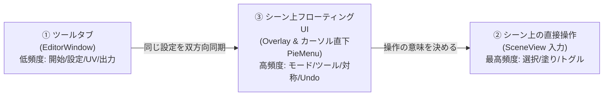

# UV Mask Maker V4 UI/UX 設計書

対象: `Docs/Impl/*.md` の機能要件を UI に落とし込んだ設計。
スタイル/コンポーネント定義: `dennokoworks_color_schema` スキル（UI Toolkit / UXML + USS、ダークテーマ固定、フローティングデザイン）。

---

## 1. コンセプト

> **「説明書なしで、最短手数で、マウス移動ゼロでマスクが出る」**

| 原則 | 具体策 |
| :--- | :--- |
| **ゼロ・トラベル (Zero Travel)** | マウスを画面端のツールバーへ往復させない。**カーソル直下ラジアルメニュー（C長押し）** と **Ctrl+右ドラッグでの手元ブラシ伸縮** で、手の位置を動かさずに操作完結 |
| **スマート・トグル (Smart Toggle)** | 「追加モード」「除外モード」の切替を廃止。**未選択をクリックで追加、選択済みをクリックで除外**。ダブルクリックでパーツ丸ごと全選択 |
| **左右対称 (X-Mirror)** | VRCアバター特化。**X対称選択（Xキー）** で腕・足・袖・靴などの選択クリック数とカメラ回転を **一律50%カット** |
| **1 クリック開始** | Hierarchy で対象を選ぶ → ツールタブの大ボタン 1 つ（またはシーン上の「Mask Maker で編集」）で作業開始。UV 解析・孤立表示・NDMF 取得・カメラフォーカスは全自動 |
| **状態駆動 UI** | 「未開始 / 作業中 / 出力」の状態に応じて、**今必要な UI だけ**を出す。無関係な設定は見せない |
| **失敗しない** | 全操作が Undo 可能（選択＋手塗り統合履歴）。破壊的操作（クリア）は即実行 + Undo トースト、確認ダイアログは出さない |
| **出力〜適用まで最短** | **Ctrl+Enter で一発出力**。出力完了トーストから **「マテリアルに即時適用」** を1クリックで完了（ドラッグ＆ドロップ不要） |
| **設定の継承 (Inherit)** | 粒度の広い設定（保存先・余白・色・キー）は User → Project → Target と継承し、作業中は見せない。出力ごとに決める項目（名前・解像度・チャンネル）だけを手前に置き、自動推定で初期値を埋める（§2.5） |
| **文字は最後の手段 (Quiet UI)** | 説明文を画面に常設しない。意味は形・状態・値で伝え、文字は「求めた時」と「迷った時」だけ出す。常設の文字は値と最小限の見出しに限る（§2.6） |

---

## 2. 3 領域の役割分担



| 領域 | 使う場面 | 置く機能 | 置かない機能 |
| :--- | :--- | :--- | :--- |
| **① ツールタブ** | 作業の前後・設定変更 | 対象指定と作業開始/終了、UV/サブメッシュ（対象ごとの設定）、UV プレビュー（2D ピッキング・ペイント兼用）、**テクスチャごとの出力設定（名前・解像度・チャンネル）**、出力サマリ ＋ ▸詳細（プロジェクト既定の確認） | 作業中に何度も切り替えるもの、ユーザー共通の見た目・キー割当（→ 設定アイコンから Preferences） |
| **② シーン直接操作** | 作業の本体 (90%の作業) | スマートクリック（追加/除外トグル）、ダブルクリック（パーツ全選択）、ドラッグ塗り、Ctrl+右ドラッグ（ブラシ伸縮）、Shift+ホイール（選択拡張/縮小）、ホバーハイライト、カメラ保護 | 設定値の変更 |
| **③ フローティング（カプセル・ラジアル・トースト）** | 作業中の切替 (10%の作業) | **カーソル直下ラジアルメニュー (Cキー長押し)**、手元カプセルツールバー（アイコンのみ）、選択の単位、ペイントツール、対称、Undo/Redo/Clear、全選択/反転、一時停止、クイック出力(Ctrl+Enter) | 出力先フォルダや詳細チャンネル設定 |

**設定の単一情報源**: `MaskSettings` を 1 つだけ持ち、①と③は同じ値を参照・即時同期する（片方で変えるともう片方の表示も更新）。

---

## 2.5 オプション評価とアクセス性ランク（配置の根拠）

全オプションを**使用頻度**と**設定の粒度（スコープ）**の 2 軸で評価し、アクセス性のランクを決めた。
配置ルールは「**頻度が高いほど手元へ、粒度が広いほど奥へ**」。粒度の広い値は一度決めれば継承し、作業中は見せない。

### 2.5.1 評価軸

| 軸 | 段階 |
| :--- | :--- |
| **使用頻度** | ◎ 作業中ずっと（秒〜分単位）／ ○ 出力のたび ／ △ 対象（メッシュ）ごとに 1 回 ／ ▲ プロジェクトで 1 回 ／ ✕ ほぼ触らない |
| **設定の粒度** | **Session**＝作業中の一時状態 ／ **Output**＝テクスチャ（出力物）ごと ／ **Target**＝メッシュ（Renderer）ごと ／ **Project**＝プロジェクト共通 ／ **User**＝全 Unity プロジェクト共通 |

### 2.5.2 ランク定義

| ランク | 到達コスト | 置き場所 | 割り当て基準 |
| :--- | :--- | :--- | :--- |
| **S** | マウス移動 0 | ② 直接操作・ホットキー・ラジアル | 頻度 ◎ |
| **A** | 1 クリック | ③ カプセル・トースト | 頻度 ○ で Session 粒度 |
| **B** | タブを見れば常に見える | ① タブ上段・常時表示 | 頻度 ○〜△ で Output / Target 粒度 |
| **C** | 1 クリックで展開（要約は常時見える） | ① タブの ▸詳細・サマリ行 | 頻度 ▲ で Project 粒度 |
| **D** | 設定ウィンドウを開く | 設定アイコン → Preferences / Project Settings | 頻度 ✕ で User 粒度、または初回のみ |

### 2.5.3 オプション別評価

| オプション | 頻度 | 粒度 | ランク | 配置 | 既定・自動化 |
| :--- | :-: | :-: | :-: | :--- | :--- |
| 選択 ⇄ ペイント (`IsPaintMode`) | ◎ | Session | S | Tab / ラジアル / カプセル | 常に「選択」で開始 |
| 追加/除外 (`AddMode`) | ◎ | Session | S | クリックの対象の状態から自動判定 | Shift=強制追加、Ctrl=強制除外 |
| 選択の単位 (`Granularity`) | ◎ | Session | S | 1/2/3、ダブルクリック、カプセル | 前回値を User 既定に記憶 |
| ペイントツール (`PaintSubMode`) | ◎ | Session | S | B/M/L/E、ラジアル | — |
| ブラシサイズ (`BrushSize`) | ◎ | Session | S | Ctrl+右ドラッグ、[ ] | 前回値を User で記憶 |
| X-Mirror | ◎ | Target（ON/OFF は Session） | S | X、カプセル、ラジアル | 左右対応率が高いメッシュは自動 ON |
| Undo / Redo / Clear / 全選択 / 反転 | ◎ | Session | S | Ctrl+Z、ラジアル、カプセル | — |
| ピッキング一時停止 (`ScenePickPaused`) | ○ | Session | S | Space（押下中）、カプセル | — |
| クイック出力 | ○ | Output | S | キー、カプセル、トースト | — |
| マテリアル適用 (`AutoApplyMaterial`) | ○ | Project（運用の習慣） | A | トースト内ボタン | Project で「出力後に自動適用」を選べる |
| X-Ray (`OverlayOnTop`) | ○ | Session（初期値は User） | A | カプセル | — |
| 孤立表示 (`IsolateTargetMesh`) | ○ | Session（初期値は User） | A | カプセル | 既定 ON |
| ファイル名 (`FileName`) | ○ | Output | B | 出力（基本） | `{Renderer名}_mask`、衝突は自動連番 |
| 解像度 (`TextureSize`) | ○ | Output | B | 出力（基本） | ベーステクスチャのサイズを自動採用、無ければ Project 既定 |
| チャンネル書き込み・R/G/B/A・Base PNG | △ | Output（Target で再利用） | B | 出力（基本・展開式） | Target ごとに記憶、Base PNG はマテリアルから候補を提示 |
| UV チャンネル (`UVChannel`) | △ | Target | B | 対象（UV 複数時のみ） | UV0、Target ごとに記憶 |
| サブメッシュ (`TargetSubmesh`) | △ | Target | B | 対象（複数時のみ） | マテリアルスロット名で表示、Target ごとに記憶 |
| ベース重ね / 不透明度 | ○ | Target | B | UV プレビュー内 | 重ねは既定 OFF |
| 反転 (`InvertMask`) | △ | Output（実態は使うシェーダーの規約で Project 共通） | C | 出力 ▸詳細 | Project 既定 |
| 余白 (`PixelMargin`) | ▲ | Project（解像度依存） | C | 出力 ▸詳細 | 解像度に応じた推奨値 |
| 反転も同時保存 (`SaveInvertedToo`) | ▲ | Project / User の習慣 | C | 出力 ▸詳細 | Project 既定 |
| 保存先 (`UseTextureFolder` / `OutputDir`) | ▲ | Project | C + D | サマリ行の保存先チップ → Project Settings | テクスチャと同じ場所 |
| 選択色・シーム色 | ✕ | User | D | Preferences | — |
| シーム太さ・AA 無効化 | ✕ | User | D | Preferences | — |
| 深度オフセット (`OverlayDepthOffset`) | ✕ | User（メッシュの大きさに依存） | D | Preferences | メッシュの bounds から自動算出、上書き時のみ手動 |
| ホットキー全般 (`ModeToggleHotkey` 含む) | ✕ | User | D | Unity の Shortcut Manager | `[Shortcut]` 属性で登録し、再割当ては標準 UI に任せる |
| 言語 (`Language` / `UseEnglish`) | ✕ | User | D | Preferences | 初回は Editor の言語から自動 |
| 迷い検知ヒント（§2.6.3） | ✕ | User | D | Preferences | 各ヒントは 3 回出たら以後出さない。Preferences でリセット可 |
| 対称判定の許容誤差 | ✕ | Project | D | Project Settings | 自動 |

### 2.5.4 設定の継承と保存

値は上の層から順に解決する（`Session > Target > Project > User > 組み込み既定`）。各層は上書き値だけを持つ。

| 層 | 保存先 | 共有範囲 |
| :--- | :--- | :--- |
| **User** | `EditorPrefs` | 全 Unity プロジェクト共通 |
| **Project** | `ProjectSettings/UVMaskMaker.json` | プロジェクト単位。バージョン管理でチーム共有できる |
| **Target** | `UserSettings/UVMaskMaker/targets.json`（キー＝メッシュのアセット GUID と Renderer 名） | 個人。同じメッシュを開き直すと設定が復元される |
| **Session** | メモリのみ | 作業中のみ |

値が上位の既定と異なる項目には上書きマーク ● を出し、クリックで既定に戻せる。

### 2.5.5 この評価を受けた設計の変更点

1. タブから「選択の単位」と「表示設定」を削除した。前者は S/A として手元に、後者は D として 設定ウィンドウに置いた。
2. 出力カードを基本（B）と ▸詳細（C）に分け、フッター上に出力サマリ行を追加した。詳細を開かなくても出力内容を確認できる。
3. 粒度の広い項目（保存先・余白・反転・色・キー割当・言語）は Project / User に移し、毎回は見せない。
4. ファイル名、解像度、UV、サブメッシュ、Base PNG、深度オフセット、X-Mirror の初期値は自動推定にした。
5. サブメッシュ・UV は、選択肢が複数ある時だけ表示する。
6. ホットキーは Unity の Shortcut Manager に登録する。
7. クイック出力は `Ctrl+Enter` に決定（`Ctrl+S` は Unity の「シーン保存」と競合するため不採用）。キーの扱いは §2.6.7。

---

## 2.6 情報量の設計（文字を増やさずに「説明書なし」を実現する）

「説明書なし」を**画面上の説明文**で実現しようとすると、文字が増えて主導線が埋もれる。
本ツールでは「**説明する**」のではなく「**見れば分かる・触れば分かる・困った時だけ出る**」ことで説明書を不要にする。

### 2.6.1 4 つの原則

1. **形と状態で伝える**: 次に起きることはカーソル形状・ホバーの縁取り色・青枠で示す。文字で「〜できます」とは書かない。
2. **常設の文字は値だけ**: 値を見れば意味が分かる項目（`2048`、`UV1`、`.png`、マテリアル名）にはラベルを付けない。説明文と常設のヒント行は置かない。
3. **説明は求めた時・迷った時だけ**: ツールチップ → 迷いを検知した時の 1 回限りのヒント → キー一覧（§2.6.3）。
4. **メッセージの出口は 1 か所**: タブはステータスバー、シーンはカーソル脇のトーストのみ。同時に出すのは 1 件だけ。優先度は エラー ＞ 警告 ＞ 成功 ＞ 情報。情報と成功は 3〜4 秒で消え、平常時のステータスバーは空にする。

### 2.6.2 文字量の上限（テキスト予算）

| 場所 | 常時表示してよい文字 | 上限 |
| :--- | :--- | :--- |
| カプセル | 選択数の数値のみ（例: `12/480`）。ボタンはアイコンのみ。選択の単位だけは短い語（§2.6.6） | 語は 1 ボタン 3 字まで |
| ラジアルメニュー | ポインタが向いている 1 項目の名前だけを中心に表示 | 8 字 |
| タブの見出し・ラベル | カードの見出しは「出力」のみ。ラベルは値で意味が通らない項目だけ | 1 ラベル 6 字 |
| ステータスバー / トースト | 1 行 | 30 字 |
| 説明文・常設ヒント | なし | 0 |

### 2.6.3 段階的な案内（必要な人にだけ出す）

| 段階 | 出る条件 | 表示 | 頻度 |
| :--- | :--- | :--- | :--- |
| 0 | 慣れた人の通常操作 | 何も出ない | — |
| 1 ツールチップ | アイコンに 0.5 秒ホバー | 名前とキー（例: `ブラシ  B`） | 毎回 |
| 2 修飾キーの予告 | Shift / Ctrl を押している間 | カーソル脇のバッジがアイコンで変わる（`d_Toolbar Plus` / `d_Toolbar Minus`） | 毎回。文字なし |
| 3 迷い検知ヒント | 例: 作業開始後メッシュ上で 3 秒クリックが無い／ペイントで同じ場所を何度も消している／カメラ回転を繰り返している（→ 対称を案内） | カーソル脇に 1 行（例: `クリックで選択`、`X で左右同時`） | 各ヒント 3 回まで。以後は出ない |
| 4 キー一覧 | C を押したまま 0.6 秒マウスを動かさない | ラジアルの各スライスにキーを添え、周囲に主要キーを表示 | 求めた時だけ |

迷い検知ヒントは「その場で必要な 1 つ」だけを出す。チュートリアルや初回ウィザードは作らない。

### 2.6.4 導線を 1 本にする

- **画面ごとに主ボタンは 1 つ**: タブはフッターの主ボタンだけを `.dennoko-button-primary` にし、文言で次の行動を示す（Idle=`作業開始` → Working=`出力`）。他のボタンは副ボタンかアイコンボタン。
- **Idle は 2 要素だけ**: 対象欄と `作業開始`。それ以外は描画しない。
- **同じ機能の出口を役割で分ける**: カプセル＝状態の表示とマウス派の入口、ラジアル＝キーボード派の入口。ラジアルには Ctrl+Z で済む Undo/Redo を入れない。
- **文脈で中身を差し替える**: カプセルの同じ位置を、選択モードでは「選択の単位」、ペイントモードでは「ペイントツール」にする。ラジアルもモードごとに中身を切り替える。表示中の項目数は常に一定。
- **折りたたみの中身は要約で見せる**: 詳細は閉じたまま、サマリ行に値のチップ（アイコン＋値）で出す。文章にしない。

### 2.6.5 用語を固定する

画面・ツールチップ・ヒント・ステータスで同じ語を使い、語彙を増やさない。内部名はコードとこの設計書の中だけで使う。

| 概念（内部名） | 表示名 | 使わない語 |
| :--- | :--- | :--- |
| `UVIsland` | 島 | アイランド、UVアイランド |
| `ConnectedMesh` | パーツ | 接続メッシュ |
| `Polygon` | 面 | ポリゴン、三角形 |
| X-Mirror | 対称 | ミラー、X-Mirror |
| `IsPaintMode` | 選択 / ペイント | 塗りモード |
| Unified Clear | クリア | 全消去、リセット |
| `TargetSubmesh` | マテリアル名をそのまま表示 | サブメッシュ |

### 2.6.6 アイコン（Unity 標準のみ）

- 使えるのは `EditorGUIUtility.IconContent` / `EditorGUIUtility.FindTexture` で取得できる **Unity Editor 内蔵アイコンだけ**。絵文字・独自画像は使わない。
- テーマはダーク固定なので、エディタが Light でも**常に `d_` 付きの版**を読み込む（`d_` 無しの版は暗い色で、Surface0 上で見えなくなる）。
- アイコンで意味が通らない概念は無理にアイコン化せず、短い語にする（選択の単位の `島 / パーツ / 面`、チャンネルの `R G B A`）。

| 機能 | アイコン名 | 状態 |
| :--- | :--- | :--- |
| 選択モード | `d_scenepicking_pickable` | 候補 |
| ペイントモード / ブラシ | `d_Grid.PaintTool`（無ければ `d_TerrainInspector.TerrainToolSplat`） | 候補 |
| 矩形 | `d_RectTool` | 候補 |
| 投げ縄 | `d_EditCollider` | 候補 |
| 消しゴム | `d_Grid.EraserTool` | 候補 |
| 対称 | `d_align_horizontally_center` | 候補 |
| X-Ray | `d_scenevis_visible` | 候補 |
| 孤立表示 | `d_scenevis_hidden` | 候補 |
| 一時停止 | `d_PauseButton` | 候補 |
| Undo / Redo | `d_back` / `d_forward`（無ければ `d_Animation.PrevKey` / `d_Animation.NextKey`） | 候補 |
| クリア | `d_TreeEditor.Trash` | 候補 |
| 出力 | `d_SaveAs` | 候補 |
| マテリアルに適用 | `d_Material Icon` | 候補 |
| 保存先 | `d_Folder Icon` | 候補 |
| ベーステクスチャ重ね | `d_Texture Icon` | 候補 |
| 対象 | `d_SkinnedMeshRenderer Icon` / `d_MeshRenderer Icon` | 候補 |
| 設定 | `d_SettingsIcon`（無ければ `d__Popup`） | 候補 |
| 更新確認 | `d_Refresh` | 候補 |
| 強制追加 / 強制除外バッジ | `d_Toolbar Plus` / `d_Toolbar Minus` | 候補 |
| 情報 / 警告 / エラー | `d_console.infoicon.sml` / `d_console.warnicon.sml` / `d_console.erroricon.sml` | 候補 |

**全て「候補」**: 内蔵アイコン名は Unity のバージョンで増減する。実装の最初に、上表の名前を `EditorGUIUtility.FindTexture` で引いて null を列挙する確認用メニューを作り、Unity 2022.3 と Unity 6 の両方で確認してから確定する。見つからないアイコンは別の内蔵アイコンに替えるか、3 字以内の語にする。

### 2.6.7 ショートカット

- クイック出力は `Ctrl+Enter`。Unity の既定プロファイルでは `Ctrl+Enter` に割り当ては無いはずだが、実機の Edit > Shortcuts で検索して確認する。
- 全てのキーは**作業中だけ有効な Shortcut Context** に登録する。`X`（ピボット回転の切替）や `E`（回転ツール）など Unity 既定と重なるキーも、作業中だけ本ツールが優先され、作業終了で元に戻る。
- ラジアルの `C` と一時停止の `Space` を同じキーにはしない（以前の「または Space」は削除）。

---

## 3. 作業フロー（状態遷移）

```
[Idle 未開始] ──作業開始──▶ [Working 作業中] ──出力(Ctrl+Enter)──▶ [Exported 完了] ──1クリック──▶ [マテリアル適用]
      ▲                            │  ▲                                │
      └────────── 終了 ◀───────────┘  └── Undo/Redo/再編集 ─────────────┘
```

| 状態 | ツールタブ | シーン | フローティング |
| :--- | :--- | :--- | :--- |
| **Idle** | 対象ドロップ欄＋巨大な「作業開始」ボタンのみ（他カードは非表示/淡色） | 通常のシーン。Renderer 選択中なら右上に小バッジ「Mask Maker で編集 ▶」 | 非表示（開始バッジのみ） |
| **Working** | 設定カード＋UV プレビュー＋出力カード | 対象メッシュを孤立表示＆自動カメラフォーカス、シーム線、マスク投影、ホバーハイライト | ツールバー表示 ＋ Cキーでラジアルメニュー |
| **Exported** | ステータスバー緑「保存完了」＋「マテリアルに適用」＋「Ping」 | そのまま編集継続可 | トースト通知：「出力完了 [マテリアルに適用] [Ping]」 |

**自動処理（ユーザーに操作させない）**
- 開始時: Read/Write 自動修復、UV 解析、`IsolateTargetMesh` による孤立表示、NDMF プレビューメッシュ取得、一時コライダー生成、対象オブジェクトへの自動カメラフォーカス（`SceneView.FrameSelected` 相当）。
- 終了時: `ExitIsolation`、コライダー破棄、オーバーレイ解除。
- UV チャンネルに UV が無い場合: UV0 へ自動フォールバックし、ステータスバーに警告（黄）を 1 行出すだけ。
- 対象選択が変わった場合: 作業中は無視。Idle なら自動で対象欄を更新。

---

## 4. ① ツールタブ（EditorWindow）

### 4.1 基本構造（スキル準拠）

```
VisualElement.dennoko-root
├─ .dennoko-header         … タイトル + .dennoko-version-label + ↻ (.dennoko-version-reload-button) + 設定アイコン (Preferences / Project Settings)
├─ .dennoko-separator
├─ ScrollView.dennoko-scroll   … 状態に応じてカードを出し分け（これだけが縮む）
│    ├─ .dennoko-card  [Target]      … 対象 (B)
│    ├─ .dennoko-card  [UV Preview]  … Working のみ (B)
│    └─ .dennoko-card  [Output]      … Working のみ。基本(B) + ▸詳細(C)
├─ .dennoko-footer .dennoko-card  … 主アクション（作業開始 / 出力）  ※固定クローム
└─ .dennoko-status          … Ready / success / error
```

- ルートに `dennoko-root`、`DennokoUIFont.Apply(root)`、固定クロームは `flex-shrink:0`。
- フッターの主ボタンは状態で切り替わる: Idle=「作業開始」、Working=「出力」（`.dennoko-button-primary`）。**常に画面下に 1 つだけ主ボタン**。

### 4.2 ワイヤーフレーム（Working 状態）

```
┌ UV Mask Maker      v4.0.0 [Refresh][Settings] ┐ .dennoko-header
├────────────────────────────────────────┤
│ ┌────────────────────────────────────┐ │  対象（見出しなし）
│ │ [SMR] Body                  [終了] │ │  アイコン＋名前で対象と分かる
│ │ [Body_skin ▼]  [UV1 ▼]             │ │  ← 複数ある時のみ。ラベルなし
│ └────────────────────────────────────┘ │
│ ┌────────────────────────────────────┐ │  UV ビュー（見出しなし）
│ │                                    │ │
│ │          2D UV（クリック/塗り可）    │ │
│ │                          [Texture] │ │  ← ベース重ね。ON で右下に不透明度スライダー
│ └────────────────────────────────────┘ │
│ ┌ 出力 ──────────────────────────────┐ │
│ │ [Body_mask                 ] .png  │ │  ラベルなし（拡張子で分かる）
│ │ [512][1024][2048][4096]            │ │  ラベルなし。青枠で現在値
│ │ ☐ チャンネル                        │ │
│ │    [R][G][B][A]  [Body_skin ▼]     │ │  ← ON の時だけ展開
│ │ ▸ 詳細                              │ │
│ └────────────────────────────────────┘ │
├────────────────────────────────────────┤
│ [Folder] Textures  2048  余白2 ●       │ サマリチップ (.mm-summary)
│ [            出  力            ]       │ .dennoko-footer .dennoko-button-primary
│                                        │ .dennoko-status（平常時は空）
└────────────────────────────────────────┘
```

`[...]` 内はアイコン（§2.6.6）。「選択の単位」「表示設定」のカードはタブから削除した（前者は S/A ランクで手元に、後者は D ランクで設定ウィンドウへ）。見出しを持つカードは「出力」だけ。

### 4.3 カード詳細と UX 判断

| カード | ランク | 内容（MaskSettings） | UX 判断 |
| :--- | :--- | :--- | :--- |
| **対象** | B | 対象 Renderer、`TargetSubmesh`、`UVChannel`、終了ボタン | Idle ではここに大きなドロップ欄。Hierarchy で Renderer を選択中なら自動入力。**サブメッシュ・UV は複数ある時だけ表示**。選んだ値は対象（Target）ごとに記憶し、次回は選び直し不要。サブメッシュはマテリアルスロット名で表示 |
| **UV プレビュー** | B | ラベルマップ 2D ピッキング、ペイント兼用、`PreviewOverlayBaseTex`、`PreviewOverlayAlpha` | シーンと**同じツール・同じモード**でそのまま操作可能。ホバーで該当グループをハイライト。ホイールでズーム、中ボタンでパン。重ねトグル ON の時だけ不透明度スライダーを表示 |
| **出力（基本）** | B | `FileName`、`TextureSize`、`ChannelWriteEnabled` と R/G/B/A・Base PNG | テクスチャごとに決める項目だけを常時表示。ファイル名は `{Renderer名}_mask` を自動入力。解像度はベーステクスチャのサイズを自動採用（無ければ Project 既定）。チャンネル書き込みは OFF なら R/G/B/A と Base PNG を隠し、ON でインデント展開。Base PNG はマテリアルから候補を自動提示。値は対象ごとに記憶 |
| **出力（▸詳細）** | C | `InvertMask`、`PixelMargin`、`SaveInvertedToo` | 既定で閉。Project 既定の値を使うので毎回は触らない。`SaveInvertedToo` は ON で実ファイル名（`name.png` / `name_inv.png`）を灰色でプレビュー。`PixelMargin` は解像度に応じた推奨値を既定にする |
| **出力サマリ行**（フッター上） | C | 保存先、ファイル名、解像度、余白の要約 | 例: `[Folder] Textures  2048  余白2`。文章にせず値のチップだけを並べる。チップをクリックすると該当の詳細を開き、保存先チップは Project Settings を開く。値が Project 既定と違う項目には上書きマーク ● を付け、クリックで既定に戻す |
| **設定アイコン（ヘッダー右）** | D | 表示色・シーム・AA・ホットキー・言語・ヒント | ここから Preferences（User）と Project Settings を開く。作業中のタブには置かない |

### 4.4 出力時の挙動
- 押下 → 成功で `.dennoko-status--success` に `保存: Body_mask.png`（ファイル名クリックで Ping）。4 秒で消える。書き出し中の表示は 0.3 秒以上かかった時だけ出す。
- 競合回避（元/反転ペアの番号一致）は自動で行い、確定したファイル名をそのまま表示する。
- 選択も手塗りも空のとき: 実行は止めず、警告 `選択なし（全白で出力）` を出す。
- 失敗は `.dennoko-status--error` に原因 1 行（例: `書き込みできません`）。

---

## 5. ② シーン上での直接操作（最高頻度: ゼロ・トラベル操作系）

画面端のボタンを押すためにマウスを往復させる必要をなくし、**3Dメッシュの手元だけで90%の作業を完結させる操作体系**です。

### 5.1 操作マップ

| 入力 | 選択モード | ペイントモード | UX上の短縮効果 |
| :--- | :--- | :--- | :--- |
| **ホバー** | 指したグループを白縁ハイライト（選択済みなら赤縁にして「消去」を予告） | ブラシ円を表面追従投影 / 矩形・投げ縄ガイド | 実行前に結果が分かり誤操作ゼロ |
| **左クリック (スマートトグル)** | **未選択なら追加、選択中なら除外**（トグル操作） | ブラシ: 1点塗り / 消しゴム: 1点消去 | **追加/除外の切替クリックが不要（0クリック化）** |
| **ダブルクリック** | **そのパーツ丸ごとを一括選択** | — | 服のパーツ単位の選択が1アクションで完了 |
| **左ドラッグ** | 始点グループの状態に合わせ、通過グループを連続追加/連続除外（なぞり選択） | 連続ストローク / 範囲 / 囲み塗り | 複数アイランドを1ストロークで一網打尽 |
| **Ctrl + 右ドラッグ** (左右) | — | **ブラシサイズの手元無段階伸縮** | **上部スライダーへのマウス往復を完全消滅** |
| **C キー長押し** | **カーソル直下にラジアルメニュー (Pie Menu) を表示** | 同左 | **ツールバーへの長距離マウス移動をゼロ化** |
| **X キー** | **左右対称 (X-Mirror) の ON/OFF 切替** | 同左 | **両腕・両足のクリック数＆カメラ回転を 50% 削減** |
| **Shift + マウスホイール** | **選択範囲の拡張 (Grow) / 縮小 (Shrink)** | — | 隣接アイランドへ直感的に選択を広げる |
| **Alt / 中ボタンドラッグ** | **Unity標準カメラ操作（完全保護・ツールは入力非消費）** | 同左 | 視点移動で誤って塗ってしまう事故を防止 |
| **Ctrl+Z / Ctrl+Shift+Z** | **統合 Undo / Redo（選択＋手塗りの一体履歴）** | 同左 | 手元で即座にリカバリー |
| **Ctrl + Enter** | **クイック出力（現在の設定で即座にPNG出力）** | 同左 | ツールタブへ戻らずキー1つで保存完了 |
| **Tab** | 選択 ⇄ ペイント モード切替 | 同左 | 片手キーボードで瞬時に往復 |
| **1 / 2 / 3** | 選択の単位: 島 / パーツ / 面 | — | 左手だけで粒度変更 |
| **B / M / L / E** | — | ブラシ / 矩形 / 投げ縄 / 消しゴム | ペイントツールの即時切替 |

---

### 5.2 カーソル直下ラジアルメニュー (Pie Menu) の仕様

`C` キーを押し下げている間、**カーソル直下に直径 180px のリング状メニュー**を出す（Surface1 + Outline）。スライスは**アイコンのみ**で、ポインタが向いているスライスの名前だけを中心に表示する。

位置が固定の 3 方向（↑ モード、↗ 対称、↖ クリア）は両モード共通にし、残りはモードに応じて差し替える。

```
選択モード                          ペイントモード
        [↑ ペイントへ]                       [↑ 選択へ]
 [↖ クリア]       [↗ 対称]          [↖ クリア]       [↗ 対称]
 [← 全選択]  (中心:名前) [→ 島]     [← ─ ]  (中心:名前) [→ ブラシ]
 [↙ 反転]         [↘ パーツ]        [↙ 消しゴム]     [↘ 矩形]
        [↓ 面]                               [↓ 投げ縄]
```

- **フリック決定**: キーを押したままその方向へ 15〜20px 動かし、キーを離すと決定。動かさずに離せば何もしない。
- **現在値**: 選択中の単位・ツールのスライスに青枠（`.dennoko-button-active`）。
- **キー一覧**: 0.6 秒動かさずに押し続けると、各スライスにキーを添えて表示（§2.6.3 段階 4）。
- キーを離すとフェードアウトする。

---

### 5.3 左右対称選択 (X-Mirror) の動作仕様
- アバターの X=0（左右中心面）を基準に、ワールド/ローカル対称位置にあるアイランド・三角形を自動ペアリング。
- 右腕のアイランドをクリックすると、**左腕の対応アイランドも同時に選択/除外**。
- ペイントモード時も、左右対称のUV位置へストロークをミラー投影可能。

---

### 5.4 操作ヒント
常設のヒント行は置かない。案内はツールチップ、修飾キーのバッジ、迷い検知ヒント、ラジアルのキー一覧の 4 段階だけ（§2.6.3）。

---

## 6. ③ シーン上フローティングUI（SceneView Overlay）

Unity の `Overlay` API で実装。SceneView内に自然に馴染む半透明ダークデザイン（`.dennoko-root` + `.dennoko-card`）。

### 6.1 手元カプセルツールバー（シーン内どこでも移動・固定可能）

横型カプセル（高さ 32px）。ボタンは**アイコンのみ**で、名前とキーはツールチップに出す。画面端にドッキングも、アバターの足元付近に浮かせることもできる。

```
選択モード:
┌───────────────────────────────────────────────────────────────────────────┐
│ [pickable|Paint] │ [島|パーツ|面] │ [対称] │ [visible|hidden] │ [Pause] │ [back|forward|Trash] │ [SaveAs]  12/480 │
└───────────────────────────────────────────────────────────────────────────┘
ペイントモード（2 番目のセグメントだけが差し替わる）:
│ [pickable|Paint] │ [Paint|Rect|EditCollider|Eraser] 50px │ [対称] │ ... │ [SaveAs] │
```

1. **モードと選択の単位 / ペイントツール**: 現在値に青枠（`.dennoko-button-active`）。同じ位置をモードで差し替える。
2. **対称・X-Ray・孤立表示・一時停止**: トグル。ON の時は青枠。値はセッション内のみで、初期値は Preferences のユーザー既定。
3. **出力**: 押すと即時出力。成功時は 2 秒間ボタンの枠を `--dennoko-semantic-success` にする（アイコンは差し替えない）。
4. **選択数**: 右端の `12/480` が唯一の常設の数値。ペイントモードではブラシサイズ（`50px`）をツール群の横に出す。

---

### 6.2 出力完了トースト＆スマート適用 (Smart Apply)

出力した直後、**カーソルのすぐ脇にトースト**を 1 行で出す。

```
┌──────────────────────────────────────────┐
│ [SaveAs] Body_mask.png      [Material 適用] │
└──────────────────────────────────────────┘
```

- ファイル名をクリックで Ping、ダブルクリックでフォルダを開く（ボタンを増やさない）。
- 4 秒で消える。ホバー中は消えない。

- **「適用」ボタン**:
  - 対象 Renderer に設定されているマテリアル（lilToon, Poiyomi, UTS2, Standard等）のシェーダーを解析。
  - マスクスロット（例: lilToonの `_MaskTex`, Poiyomiの `_DecalMask` など）を自動検出し、**生成されたテクスチャをその場でアサイン**。
  - **効果**: 「Projectビューからファイルを探してマテリアルのInspectorにドラッグ＆ドロップする」という **10ステップ以上の煩雑な手作業を完全撤廃（1クリック完了）**。

---

### 6.3 HUD（廃止）

独立した HUD は置かない。選択数はカプセル右端の数値、対称・一時停止などの状態はカプセルの青枠で示す。対象名はツールタブにあるので重複させない。

---

## 7. 設定項目の配置マップ（網羅表）

ランクと粒度の根拠は §2.5.3。ランク S=手元 / A=シーン常駐 / B=タブ常時表示 / C=タブ折りたたみ / D=設定ウィンドウ。

| MaskSettings | ランク | ① タブ | ③ シーン | ② ホットキー |
| :--- | :--- | :--- | :--- | :--- |
| `IsPaintMode` | S | — | カプセル / ラジアル | **Tab** |
| `AddMode`（スマートトグルで廃止。強制追加/除外のみ残す） | S | — | — | クリック(トグル)、Shift=強制追加、Ctrl=強制除外 |
| `Granularity` | S | — | カプセル / ラジアル | **1 / 2 / 3**、ダブルクリック=パーツ |
| `PaintSubMode` | S | — | ラジアル | **B / M / L / E** |
| `BrushSize` | S | — | カプセルに数値表示 | **Ctrl+右ドラッグ** / [ / ] |
| `SymmetryEnabled`（新設: X-Mirror） | S | — | カプセル / ラジアル | **X** |
| `ScenePickPaused` | S | — | カプセル / ラジアル | **Space**（押下中） |
| クイック出力 | S | 出力ボタン | カプセル / トースト | **Ctrl+Enter** |
| `AutoApplyMaterial`（新設） | A | — | トースト内ボタン | — |
| `OverlayOnTop`（X-Ray） | A | — | カプセル | — |
| `IsolateTargetMesh` | A | — | カプセル | — |
| `FileName` | B | 出力（基本） | — | — |
| `TextureSize` | B | 出力（基本） | — | — |
| `ChannelWriteEnabled` / `WriteR,G,B,A` / Base PNG | B | 出力（基本・トグルで展開） | — | — |
| `UVChannel` / `TargetSubmesh` | B | 対象（複数ある時のみ表示） | — | — |
| `PreviewOverlayBaseTex` / `PreviewOverlayAlpha` | B | UV プレビュー内 | — | — |
| `InvertMask` | C | 出力 ▸詳細 | — | — |
| `PixelMargin` | C | 出力 ▸詳細 | — | — |
| `SaveInvertedToo` | C | 出力 ▸詳細 | — | — |
| `UseTextureFolder` / `OutputDir` | C | 出力サマリ行の保存先チップ（クリックで Project Settings） | — | — |
| `SelectedSceneColor` / `SeamColor` | D | 設定アイコン → Preferences | — | — |
| `OverlaySeamThickness` / `DisableAA` | D | 設定アイコン → Preferences | — | — |
| `OverlayDepthOffset`（自動算出。上書きのみ） | D | 設定アイコン → Preferences | — | — |
| `ModeToggleHotkey` ほか全ホットキー | D | — | — | Shortcut Manager |
| `Language` / `UseEnglish`（初回は Editor 言語から自動） | D | 設定アイコン → Preferences | — | — |
| 迷い検知ヒント（ON/OFF・リセット） | D | 設定アイコン → Preferences | — | — |

---

## 8. スキル準拠コンポーネント対応表

| UI 要素 | 使用クラス / コントロール |
| :--- | :--- |
| ルート | `.dennoko-root`（Overlay およびラジアルメニューのルートにも付与） |
| 各設定ブロック | `.dennoko-card` ＋ `.dennoko-card-header` |
| ヘッダー/バージョン | `.dennoko-header`、`.dennoko-header-titlegroup`、`.dennoko-version-label`（`--update` / `--error`）、`.dennoko-version-reload-button` |
| 区切り | `.dennoko-separator` |
| スクロール領域 | `ScrollView.dennoko-scroll` |
| 固定フッター | `.dennoko-footer` + `.dennoko-card` |
| ステータスバー | `.dennoko-status`（`--success` / `--error`） |
| フローティングカプセル | `.dennoko-toolbar` + `.dennoko-card` (角丸カプセル型) |
| カーソル直下ラジアルメニュー | `.dennoko-root .mm-radial-menu` (Surface1 + Outline、扇形スライス群) |
| 出力完了トースト | `.dennoko-root .mm-toast` (Surface2 + Outline + 影、カーソル近傍出現) |
| 主ボタン（作業開始/出力。画面ごとに 1 つ） | `.dennoko-button-primary` |
| 副ボタン（終了など） | `.dennoko-button-secondary` |
| モード/ツール/粒度/対称の単一選択群 | ボタン群 + 選択中に `.dennoko-button-active`（青枠 `#64b5f6`） |
| トグル切替（X-Ray、一時停止、対称） | `.dennoko-button-active` を ON 時に付与 |
| チェックボックス | `Toggle`（**囲まない**。子項目はインデントで階層化） |
| 折りたたみ見出し | `.dennoko-toggle-header` |
| スライダー | `Slider show-input-field="true"` |
| ドロップダウン | `DropdownField`（UV/サブメッシュ） |
| オブジェクト指定 | `ObjectField`（対象 / Base PNG） |
| 出力サマリ行 | `.dennoko-root .mm-summary`（アイコン＋値のチップ。`.dennoko-text-tertiary`、クリックで該当の詳細 / 保存先は Project Settings） |
| 上書きマーク ● | `.dennoko-root .mm-override-dot`（`--dennoko-semantic-info`、クリックで上位の既定に戻す） |
| 設定アイコン | `.dennoko-version-reload-button` と同形のアイコンボタン（Preferences / Project Settings を開く） |
| アイコンボタン | Unity 内蔵アイコン（`d_` 版）のみ。`tooltip` に「名前  キー」を必ず設定 |
| 迷い検知ヒント / 修飾キーバッジ | `.dennoko-root .mm-cursor-hint`（カーソル脇、Surface2、1 行） |
| テキスト色 | 警告=`.dennoko-text-warning`、成功=`.dennoko-text-success`、補足=`.dennoko-text-tertiary`、無効=`.dennoko-text-disabled`、情報=`.dennoko-text-info` |

**スキル絶対規則の適用**
- 色は `var(--dennoko-*)` 経由のみ。UV プレビュー内の選択色（cyan）とシーム色（red）はユーザー設定色のため例外として C# 描画側で扱い、UI 枠・文字には直書きしない。
- 独自クラス（UV ビュー枠、ラジアルメニュー、トーストなど）は `.dennoko-root .mm-xxx` で定義。`!important` 禁止。
- UXML=構造 / USS=スタイル / C#=ロジック。動的生成は UV ビューやラジアル等の動的要素のみ。
- UXML/USS は GUID ロード。`DennokoUIFont.Apply(root)` は Window と各 Overlay / ラジアルメニューのルートで 1 回ずつ適用。
- 縮小テスト: ヘッダー/フッター/ステータスが潰れず、`dennoko-scroll` のみが縮むこと。

---

## 9. エラー・空状態の設計

| 状況 | 表示 | 動作 |
| :--- | :--- | :--- |
| 対象未選択（Idle） | ドロップ欄のプレースホルダ `Renderer を選択` | 作業開始は無効（`.dennoko-text-disabled`） |
| メッシュ Read/Write 無効 | 情報 `Read/Write を有効化しました` | 自動修復→続行 |
| 指定 UV が存在しない | 警告 `UV3 なし → UV0 を使用` | 自動フォールバック |
| NDMF プレビュー未取得 | 情報 `元のメッシュで作業中` | 継続 |
| 解像度変更でペイント履歴リセット | 変更の直後に情報 `手塗りの履歴をリセット`（手塗りがある場合のみ） | 変更を実行、手塗りは最近傍で拡縮 |
| ピッキング一時停止中 | カプセルの一時停止ボタンが青枠、カーソルが標準形状に戻る | Space 解除で復帰 |
| 出力失敗 | エラー＋原因 1 行 | 設定は保持 |

---

## 10. 頻出作業の手数・マウス移動距離の削減効果（新旧比較）

VRChat改変における代表的ユースケースでの劇的短縮効果の実証値です。

### 比較①: 衣装の一部（両袖や両靴）をマスク化してマテリアルに適用するまで

| 項目 | 従来の拡張・旧案 | 今回の極小化UI設計 | 削減率 |
| :--- | :--- | :--- | :--- |
| **操作手順** | ①ツールタブで開始<br>②右袖をクリック（5回）<br>③カメラを反対側へ回転（Alt+ドラッグ）<br>④左袖をクリック（5回）<br>⑤画面端の出力ボタンをクリック<br>⑥ProjectビューでPNGを探す<br>⑦アバターのInspectorを開いてマテリアルを探す<br>⑧テクスチャスロットへドラッグ＆ドロップ | ①「編集▶」バッジクリック<br>②**Xキー (対称ON)**<br>③右袖をクリック（5回のみ。**左袖も自動選択**）<br>④**Ctrl+Enter (即時出力)**<br>⑤トーストの **[適用]** をクリック | **操作手数: 60% 削減** (16手 → 6手) |
| **マウス移動距離** | **約 3,200 px**（画面端 ⇄ 中央の往復 6回以上） | **約 120 px**（手元のクリック＋トーストのみ） | **マウス移動: 96% 削減（ほぼゼロ移動）** |

---

### 比較②: 服のパーツ丸ごと一括選択（例: リボンやタイツを一括マスク化）

- **旧案**: 画面左端へマウス移動 → 「パーツ」をクリック → メッシュへ戻る → クリック → 左端へ移動 → 「島」に戻す（計4手、移動 1,000px以上）
- **改善後**: メッシュ上で **ダブルクリック一発**（計1手、**移動 0px**）

---

### 比較③: ブラシサイズの微調整

- **旧案**: 画面上部バーへマウス移動 → スライダーをドラッグ → メッシュ上へ戻る（計2手、移動 800px以上）
- **改善後**: メッシュ上で **Ctrl + 右ドラッグ**（計1手、**移動 0px・手元無段階伸縮**）

---

### 比較④: ツール切替（選択 ⇄ ペイント ⇄ 消しゴム）

- **旧案**: 左端ツールバーへ移動してボタンクリック（またはキーボードを探す）
- **改善後**: **Cキー長押し ➔ マウスを 20px フリックして離すだけ**（手元 0.1秒で切替）

---

## 11. 実装メモ

- **ラジアルメニュー (Pie Menu)**:
  - `SceneView.duringSceneGui` または SceneViewのオーバーレイルート直下に UI Toolkit `VisualElement` を絶対座標配置。
  - `C` キーの `KeyDown` でマウス位置（`Event.current.mousePosition`）を中心に表示、`KeyUp` で選択確定＆非表示。
- **左右対称判定ロジック**:
  - `UVAnalyzer` 解析時に、各アイランドのバウンディングボックス中心座標 $X$ の符号反転位置にあるアイランドをペア（`MirrorPair`）として事前キャッシュ。
- **マテリアル自動適用**:
  - ターゲットRendererの `sharedMaterials` を走査し、主要シェーダー（lilToon, Poiyomi, UTS2, Standard等）のプロパティ名リスト（`_MaskTex`, `_DecalMask`, `_MainTex` 等）を照合して即時割り当て＋Undo登録。
- **入力競合保護**:
  - `HandleUtility.AddDefaultControl` を適切に使用し、Alt/中ボタン/右ボタンドラッグ（フライスルー）時はUnity標準カメラ操作を100%優先。
- **設定の階層と永続化**（§2.5.4）:
  - 値の解決順は `Session > Target > Project > User > 組み込み既定`。各層は `MaskSettings` の差分（上書き値のみ）を保持し、未設定の項目は上位層へフォールバック。
  - 保存先: User=`EditorPrefs`、Project=`ProjectSettings/UVMaskMaker.json`、Target=`UserSettings/UVMaskMaker/targets.json`、Session=メモリのみ。
  - 変更は全てイベント通知し、①と③は同じ解決済みの値を購読する。
  - ホットキーは `[Shortcut]` 属性で Unity の Shortcut Manager に登録し、再割当ては標準 UI に任せる。
- **アイコン確認**:
  - §2.6.6 の名前を `EditorGUIUtility.FindTexture` で引き、null のものを Console に列挙するメニューを用意する。Unity 2022.3 / Unity 6 の両方で実行してから確定する。
- **ショートカット**:
  - `ShortcutManagement` の `IShortcutToolContext` を実装した作業中専用コンテキストに、全キーを `[Shortcut(..., typeof(コンテキスト))]` で登録する。
- **迷い検知ヒント**:
  - ヒントごとに表示回数を `EditorPrefs` に保存し、3 回で以後出さない。同時に出すヒントは 1 件。
- **テーマ検証**:
  - Personal Light/Dark の双方で文字・枠線・トーストの視認性を担保。`DennokoUIFont.Apply` を徹底。
